# Timesheets UX review (staff and admin), 2026-11-02

Scope: every timesheet screen and flow on current `main` (d86e5fe2, after #592 and #593), reviewed in the
browser with fictional local data at 1440px and 390px, in Herbal (light) and Dark. Benchmarks: Homebase,
Deputy, When I Work, Gusto Time Tools, QuickBooks Time and Square Team, plus Rupert's own
[interface guidelines](../ui-standards.md). Findings are ranked by impact on the two jobs that matter:
**staff record and submit true hours with no friction**, and **a reviewer approves a week confidently in
under a minute**.

Screenshots: `docs/audits/timesheets-2026-11/` (before and after of the key screens).

## Map of screens and flows

| Who | Screen | Route | Job |
| --- | --- | --- | --- |
| Staff | My time (home) | `/employee` | Clock in/out, this week's hours and pay estimate, open the week's timesheet |
| Staff | Time clock | `/time_clock` | Clock in/out, shift history, request a correction |
| Staff, manager | Fix clock-out | `/time_clock/shifts/:id/fix` | Correct a forgotten clock-out (#593) |
| Staff | My timesheets | `/people/timesheets` | List of own weeks |
| Staff | Timesheet (draft) | `/people/timesheets/:id` | Import clock shifts, add/edit/remove entries, submit |
| Staff | Timesheet (in review / approved / returned) | same | Read state, see comment, reopen when returned |
| Staff | My reports, pay, time off | `/employee/reports`, `/employee/pay`, `/employee/time-off` | Personal history and downloads |
| Reviewer | Timesheets | `/people/timesheets` | Review queue, filters, bulk approve, week calendar, weeks at a glance, time off, sources |
| Reviewer | Review timesheet | `/people/timesheets/:id` | Check days against shifts, approve / approve & next / return |
| Reviewer | All sources, calendar | `?view=unified`, `?view=calendar` | Rupert, Square and C-Trax time in one place |
| Reviewer, payroll admin | Clock corrections | `/time_clock` (bottom), timesheet page | Approve or reject correction requests |
| Reviewer | Punch report, Square / C-Trax history, pay runs | `/people/punch_history`, … | Source evidence and payroll |
| Native/API | `/api/v1/employee/*` | — | Same workflow for the mobile app (unchanged by this work) |

States: timesheet `draft → submitted → approved | rejected → (reopen) draft`; payroll-locked when a payslip
covers it; demo records; clock shift open / closed / stale-open (never clocked out); correction pending /
approved / rejected.

## Findings, ranked by impact

### Critical (wrong numbers, dead ends, or the main action hidden)

1. **Hours are rounded to one decimal on lists and totals while days use two.** A week of
   7.5 + 7.5 + 8.25 + 7.5 + 7.5 = 38.25 h shows **38.3** as the total. A reviewer comparing the total
   with the days sees a mismatch, and on payroll-adjacent screens a mismatch reads as a bug. Every leading
   product shows hours to two decimals (or h:mm) everywhere. *Fix: one `format_hours` helper, two
   decimals, used on every timesheet surface.*
2. **Clock corrections dead-end for the people who review time.** Managers and shift leaders review
   timesheets, but approving a clock correction needs `payroll.write` (admins only), and the queue lives at
   the bottom of the personal **Me → Time clock** page. A timesheet with a pending correction cannot be
   approved, and its reviewer cannot see why or where to resolve it. *Fix: show pending corrections on the
   Timesheets review page and on the affected timesheet, with the action for payroll admins and a plain
   "waiting for a payroll admin" line for others. Owner decision (not changed here): whether timesheet
   reviewers should also approve corrections.*
3. **The reviewer cannot see clock-in/out times.** The review page lists days and hours only ("Imported
   from time clock"). Every benchmark puts in/out punches next to hours, because that is what a reviewer
   checks. *Fix: one day-by-day table with clock in → out per entry.*
4. **On a phone, staff must scroll past a whole lessons card to reach Clock in/out.** The learning welcome
   renders above the clock on `/employee`. Clocking in is the single most frequent staff action. *Fix: the
   clock card leads the page; the welcome follows.*
5. **Staff must build their own timesheet by hand.** "Start this week's timesheet" creates an empty draft;
   **Import clock shifts** is hidden in the `More` menu. Leading products build the week from punches
   automatically; staff only check and submit. *Fix: opening the week imports finished shifts; a draft
   shows unimported shifts and an `Import clock shifts` button on the page.*
6. **The staff home week and the pay week disagree.** Home shows Monday–Sunday "This week" while the
   timesheet and pay period are Thursday–Wednesday (Pay rules). Mid-week, home says "Timesheet hours 0 h,
   $0.00" while the person has been clocked in for hours. *Fix: home uses the pay period, shows clocked
   hours and timesheet hours side by side, and the day tiles show clocked time.*
7. **"Weeks at a glance" counts Monday weeks in the future.** Timesheets follow Thursday–Wednesday pay
   periods and are created after the work, so the panel always read "0 timesheets" for four future weeks.
   *Fix: the current and three previous pay periods, with waiting / approved / returned / draft / missing.*

### High (slow review, unclear state, error-prone input)

8. **Status words disagree.** The filter says *Needs review*, the pill says *Submitted*, the API says
   *submitted*, the guidelines say *In review*; *rejected* shows as *Rejected* on the pill and *Returned for
   correction* in the filter. Submitted uses the olive (info) pill rather than clay (waiting). *Fix: one
   status vocabulary and pill per state: Draft (taupe), In review (clay), Approved (fern), Returned (rose).*
9. **The detail page does not say what happens next.** State, who acted and the review comment are
   scattered (comment at the bottom). *Fix: a status line under the header: what state, who, when, and the
   one next step; the return comment shown first for staff.*
10. **The reviewer has to read the title to learn whose week it is.** Title is the period, name is the
    subtitle. *Fix: title is the staff member; the period is the subtitle; eyebrow "Timesheet".*
11. **Submitting has no confirmation or summary.** One tap sends the week. *Fix: confirm with the total
    hours and that it locks until reviewed.*
12. **Add entry defaults invite double counting.** Defaults to the last day of the period with 8 hours,
    even when that day was already imported from the clock. *Fix: default to the first day with no hours,
    no preset hours, and a hint that clock shifts import automatically.*
13. **Two tables say the same thing.** *Day by day* and *Entries* repeat each other. *Fix: one table, one
    row per entry, empty days shown, a total row.*
14. **Compensation figures fill the page with zeros.** Six stat cards, three of them commission/card bonus
    at $0.00, then a second "Compensation breakdown" with the same zeros. Same for the list's `Comp.` and
    `Other` columns. *Fix: show compensation only when there is any; one place.*
15. **Staff see the reviewer's tools.** My timesheets shows a staff search, "Staff member" column, status
    filter with reviewer wording and three source cards. *Fix: staff get period, hours, status and the next
    action.*
16. **Time clock history is a wall of cards with seconds and repeated dates.** No weekly totals. *Fix: a
    compact table grouped by pay week with weekly totals; seconds only in correction inputs.*

### Medium (consistency, polish, phone)

17. Timestamps use five formats (`Nov 02 07:29`, `Nov 2, 2026 4:17:25 AM EST`, `October 22, 2026`, …).
    Guidelines: `Oct 21, 2026`, `3:40 PM`, ranges `Oct 1 – Oct 21, 2026`. *Fix: `timesheet_time` and
    `period_range` helpers.*
18. Phone overflow: the staff navigation row and the week calendar's controls widen the page on 390px;
    the entry actions are cut off on phones. *Fix: scrolling nav row, wrapping controls, row actions that
    fit.*
19. History says `Import shifts · Ana Rivera`, `Submit`. *Fix: past-tense sentences ("Imported clock
    shifts", "Submitted for review", "Returned for correction: note").*
20. "waiting 2 minutes" under the status. *Fix: "Sent 2 minutes ago".*
21. The bulk-approve comment field's placeholder is cut off; "Select all 4" checkbox has a label but no
    indication of how many are selected. *Fix: wider field and a live count on the button.*
22. The calendar view's day cells are `role="button" tabindex="0"` with no action: keyboard and screen
    reader users land on dead controls. *Fix: plain cells with an accessible label.*
23. A dead query: `@missing` (missing timesheets) is computed on every reviewer load and never shown, and
    uses Monday weeks. *Fix: use pay periods and show it in "Pay periods" as "no timesheet".*

### Low (nice to have, noted for later)

24. Breaks are not modelled (punch in/out only). Benchmarks track paid/unpaid breaks; owner rules say no
    rounding and no breaks today. Not changed.
25. Time zone is stated as "Eastern Time (US & Canada)" in a subtitle; times on the page carry EST/EDT on
    each line. Kept once per page, and per time only where a period crosses a DST change.
26. Overtime is off by owner decision (#423); when it is turned on, the weekly threshold flag already
    exists. No change.

## Standards adopted (both sides use these)

| Piece | Standard | Where |
| --- | --- | --- |
| Status | `timesheet_status_pill(sheet)`: Draft (taupe), In review (clay), Approved (fern), Returned (rose). Filter labels use the same words. | `TimesheetsHelper`, list, detail, calendar, staff home |
| Next step | `timesheet_state_note(sheet, viewer)`: one sentence that says what happens next for this viewer | detail header |
| Hours | `format_hours(value)`: two decimals, `h` suffix in prose, plain in tables; `–` for none | everywhere |
| Times | `timesheet_time(t)` → `Oct 22, 2026, 9:00 AM`; `shift_span(a, b)` → `9:00 AM – 4:30 PM` (date added when overnight) | detail, time clock, corrections |
| Periods | `period_range(a, b)` → `Oct 22 – 28, 2026` (months and years only when they differ) | titles, lists, home |
| Day table | One row per entry, empty days shown, clock in → out, total row | detail |
| Confirmations | Submit, approve selected, remove entry and reopen confirm with what changes | detail, list |
| Words | Add, Edit, Save, Remove, Open, Review, Approve, Return for correction, Import clock shifts, Submit for review | everywhere |

## Changes by pass

### Pass 1: standards and the highest-impact fixes

- **Shared vocabulary** (`TimesheetsHelper`, `.callout`, `.timesheet-*` styles, guidelines §5 and the Style guide):
  status pills and words, two-decimal hours, shift spans, pay-period labels, history sentences.
  `Timesheet#period_label` now reads `Oct 22 – 28, 2026` everywhere it is used (#1, #8, #17, #19).
- **Timesheet page** (staff and reviewer): staff member as the title, a status line with the next step, callouts for
  a return comment, unimported clock shifts (with `Import clock shifts` on the page) and pending corrections; one
  day-by-day list with clock in → out, empty days and a total; submit confirms the hours; hand entries default to
  the first empty day with no preset hours; compensation shown only when there is any (#3, #5, #9–#14).
- **Timesheets list**: In review / Returned wording, `Review` as the row action, staff see period, hours and status
  only, a clock-correction callout for reviewers, **Pay periods** (this and the three previous Pay-rules periods,
  with people who clocked time but have no timesheet) replacing future Monday weeks; the unused missing-week query
  is gone (#2, #7, #8, #15, #20, #21, #23).
- **Staff home**: the clock leads (lessons follow it), the week is the pay week, clocked hours and timesheet hours
  side by side, day tiles show clocked time, one large clock button; opening the week imports finished shifts
  (#4, #5, #6).
- **Time clock**: shifts grouped by pay week with weekly totals, `9:00 AM – 4:30 PM` rows, a compact `Correct`
  disclosure, and a `Corrections to review` queue reachable from Timesheets (#2, #16).
- **Phones**: `.table-region` is now `position: relative`, so absolutely positioned screen-reader labels in table
  headers no longer widen the page. This fixes sideways scrolling on every table page, not only timesheets (#18).

### Pass 2: second browser review

- Clock-imported rows no longer offer hours/date editing or Remove: either made submission fail later ("Clock times
  have changed"). Type and note stay editable; a link sends the person to request a correction instead.
- The review form moved below the days (evidence, then decision) with a `Go to review` link in the status line;
  flags sit with the status.
- The current pay period no longer reads "worked, no timesheet" (it says "clocked, not started"); older periods are
  "2 pay weeks ago" rather than a date printed twice.
- List columns that are empty or repeat the total (Regular, To check) are hidden; the Regular card is hidden when it
  equals the total.
- Staff home shows `–` and a reason for the pay estimate until clocked hours are on the timesheet, instead of $0.00.
- Calendar view counts an open shift's hours so far; the subtitle typo ("Eastern Time time") is fixed.
- Time-source cards use two-decimal hours and `Open` links; staff preview pages, the staff profile and the dashboard
  widget use the shared status pill and hours.

### Pass 3: polish, accessibility and edge cases

- Returning a timesheet on the web needs a comment saying what to fix (the staff app API is unchanged).
- Overnight shifts say which part of the day each row is ("hours until midnight" / "after midnight"); `Long day`
  flags the day total, also when a day has several entries; each day list states the time zone once.
- Calendar cells are a list with real links instead of `role="button"` cells with no action; out-of-month numbers
  meet contrast; today carries `aria-current="date"`.
- Correction inputs keep seconds, so an unchanged clock-in is not silently moved by up to 59 seconds.
- Correction approvals started from a timesheet return to it; only `/people/timesheets/:id` paths are accepted.
- axe (WCAG 2 A/AA and best practice) reports no violations on the nine timesheet pages in Herbal and Dark.

### Verification

- Tests: `test/helpers/timesheets_helper_test.rb` (hours, periods, overnight and DST spans, statuses, history) and
  `test/integration/timesheet_experience_test.rb` (week import from the clock, unimported-shift callout and entry
  defaults, pay periods and blocked corrections, returned-week flow and required note, safe return path, clock
  before lessons). Existing tests were updated only where wording changed on purpose.
- Screens checked at 1440px and 390px in Herbal and Dark with fictional local data; no page scrolls sideways.

### Owner decisions (not changed here)

- Decided 2026-11-02: timesheet reviewers (admins, managers, shift leaders) also approve clock corrections
  (`ClockCorrection.reviewer?`); before, only payroll writers could. Nobody reviews a correction to their own shift.
- Breaks: punches are in/out only; tracking paid/unpaid breaks would need a model change.

## Before and after

| Screen | Before | After |
| --- | --- | --- |
| Reviewer: Timesheets list | 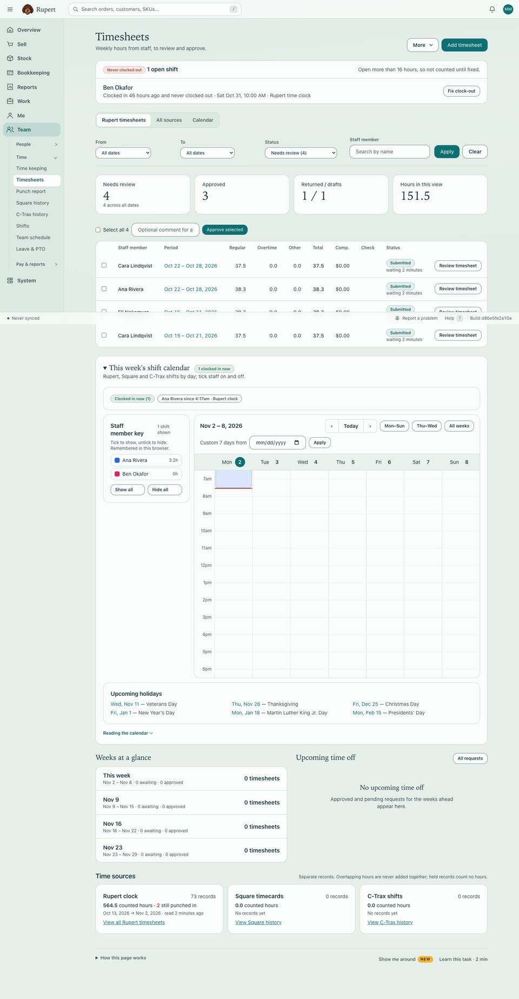 | 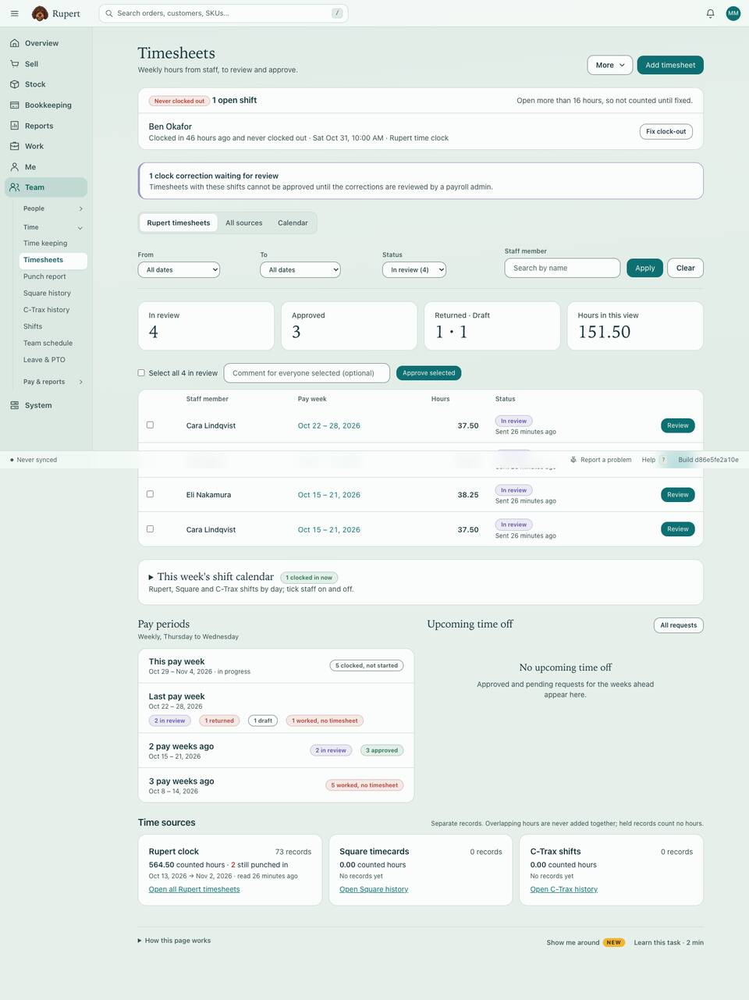 |
| Reviewer: review a week | 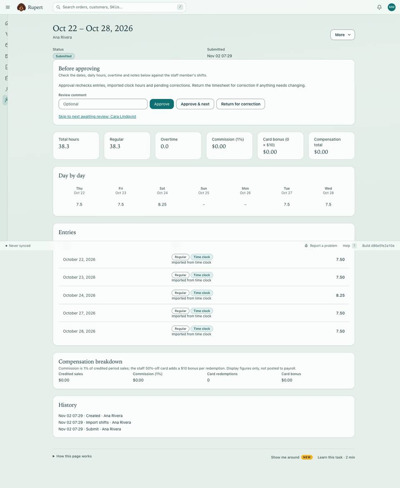 | 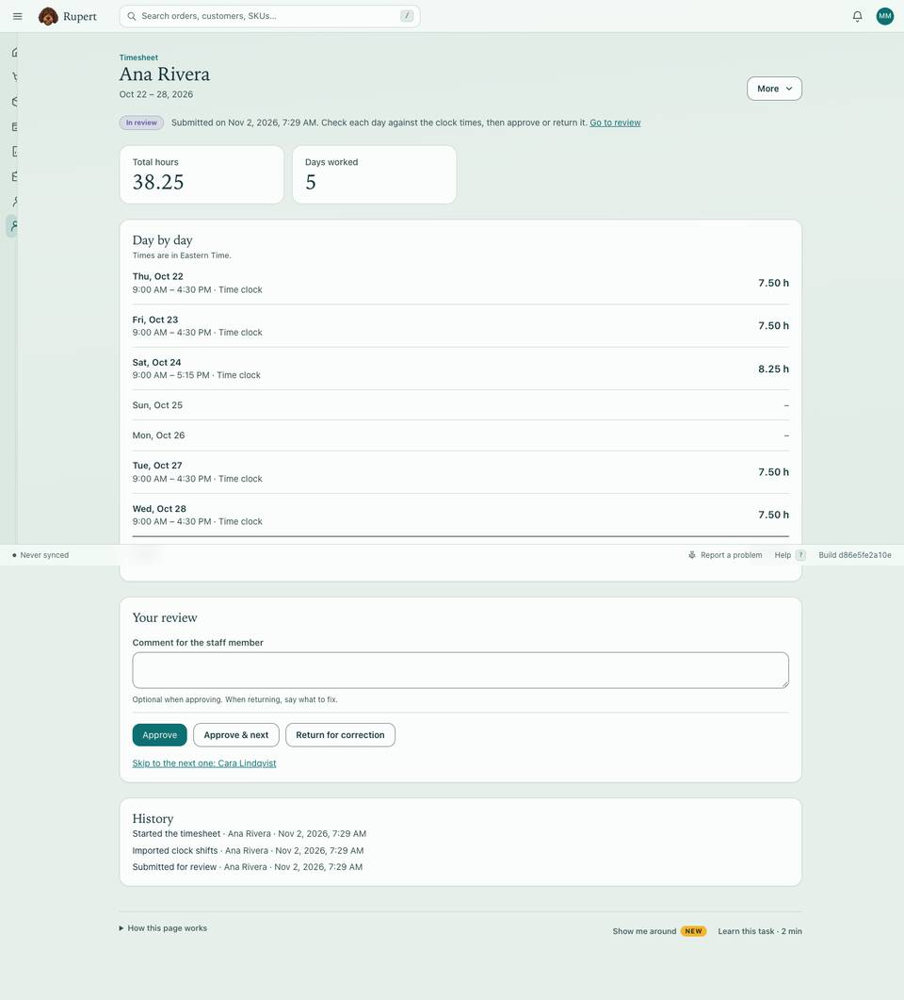 |
| Reviewer: review a week (Dark) | 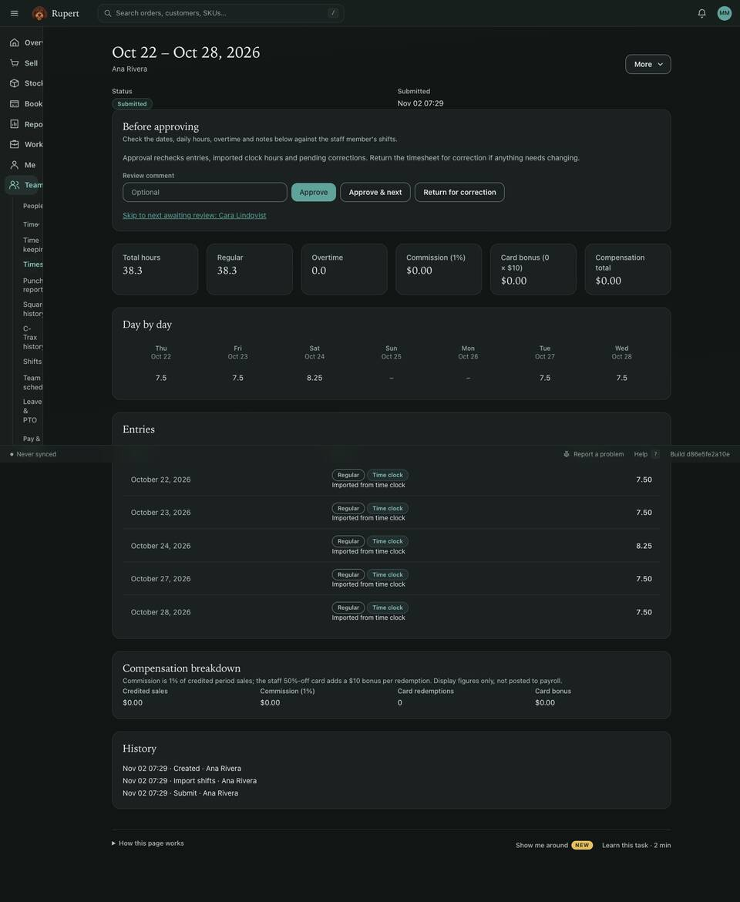 | 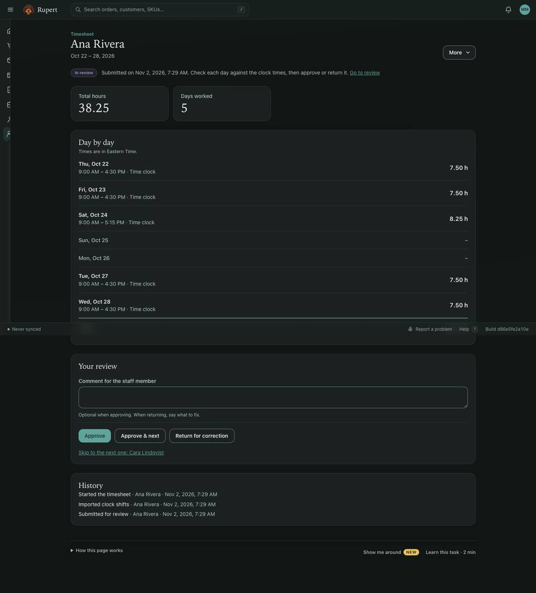 |
| Manager: time clock | 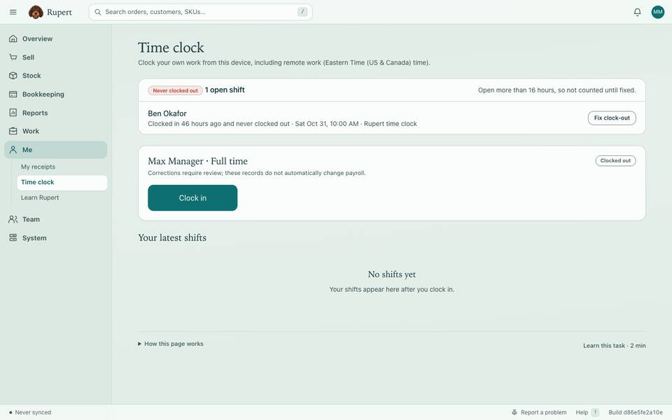 | 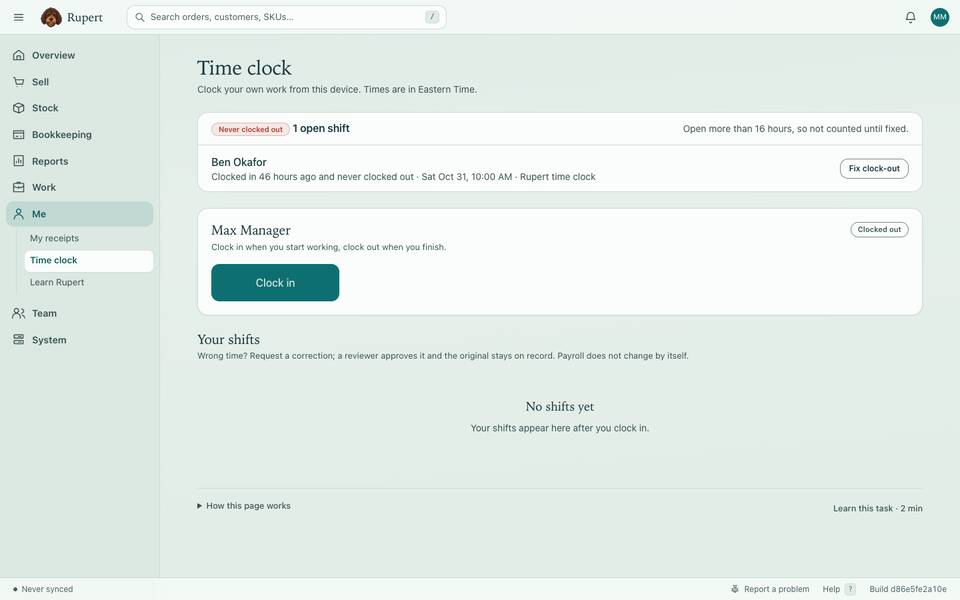 |
| Staff home (phone) | 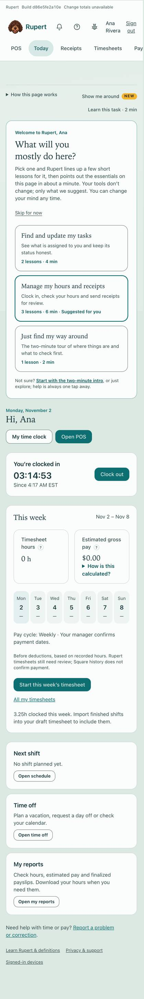 | 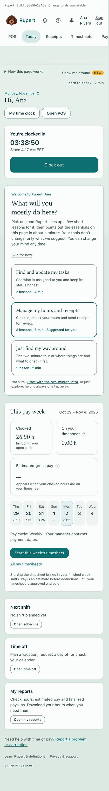 |
| My timesheets (phone) | 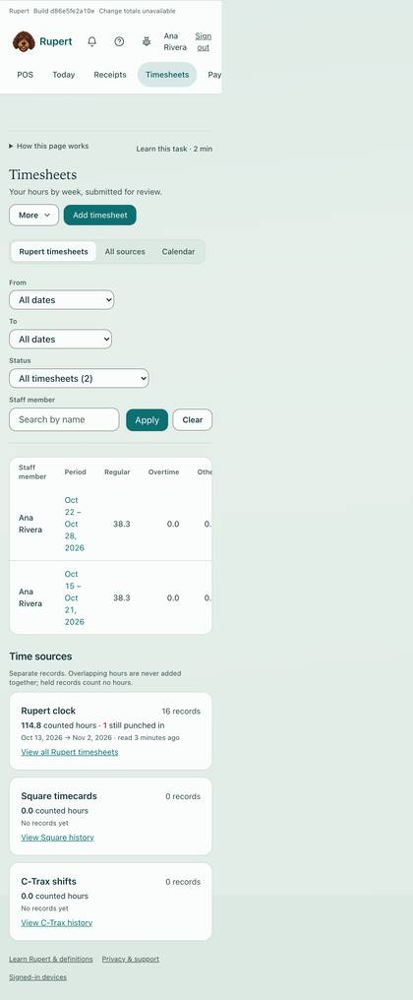 | 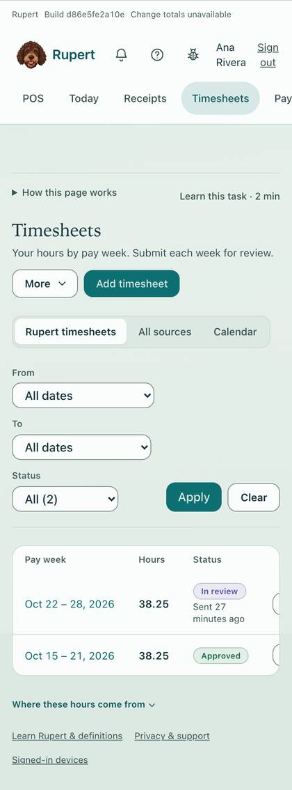 |
| Draft week (phone) | 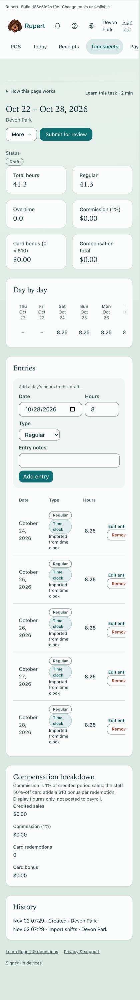 | 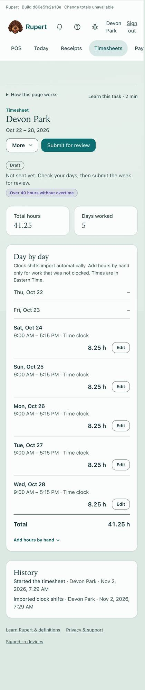 |
| Time clock (phone) | 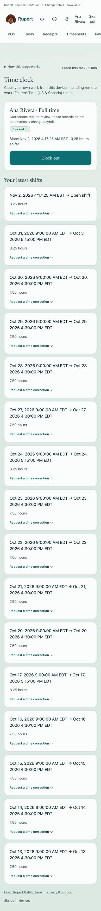 | 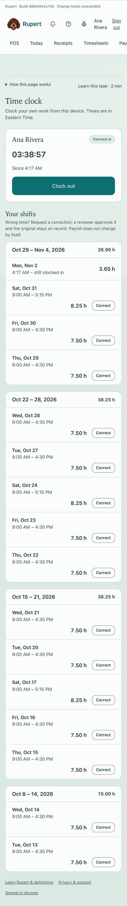 |
