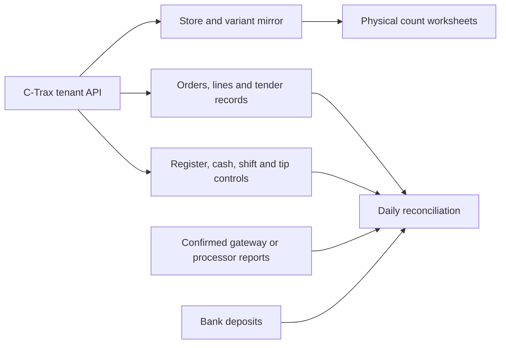

> Historical investigation retained during repository reconciliation. Later deployment and access findings supersede its operational status. [Original revision](https://github.com/techmore/rupert/blob/a249ae02f18ae955cd42e5a0665af85037ed993c/docs/ctrax-integration-research.md).

# C-Trax integration investigation and implementation plan

Reviewed **October 15, 2026 (America/New_York)** against the publicly served C-Trax Serv admin client **2.0.86** and Rupert's stock connector. This document records an investigation, not a successful live integration or a vendor-supported API specification.

**Finding:** Rupert can use a real structured C-Trax API for stock and has credible read paths for orders, registers, cash drops, labor shifts, tips and sales reports. A merchant-account connection is a separate payment configuration; it has not been shown to provide the stock or complete settlement data Rupert needs. Start with C-Trax business reads, then obtain the actual gateway/processor reporting contract for deposits and fees.

## Evidence and current readiness

| Evidence level | What it establishes | What it does not establish |
| --- | --- | --- |
| Official C-Trax material | C-Trax advertises an Open API, role-controlled reporting, and product/report exports. [S01], [S03], [S04] | Authentication contract, service accounts, documented scopes, limits, webhooks, account entitlement or API stability. |
| Public native admin client | Request methods, paths, parameter names, selected response fields and UI calculations. | Successful account reads, backend defaults, complete response schemas, correctness of financial labels or contractual permission to automate. |
| Prior signed-in UI inspection | Products, store selection, export controls and merchant settings were accessible during that session. | An indefinitely reusable browser session, unattended server authentication or another account's permissions. Account-specific findings are private. |
| Production network/login tests | The configured HTTPS API was reachable from SER8; attempted API logins returned HTTP 401. A supplied combination was also rejected by the native login form. | A successful import. No production stock snapshot has been published by these attempts. |
| Rupert code/tests | Encrypted tenant setup, bounded stock reads, native-ID snapshots/count comparisons and an hourly job are implemented. | Vendor acceptance, complete stock coverage on the real account, imported sales or settlement reconciliation. |

The [client surface catalog](data/ctrax-client-surface.json) inventories **104 unique method/path pairs** from the public core and **75 business/navigation chunks**: **54 GET** and **50 POST/PUT/DELETE** entries. Four entries belong to the separate support service, leaving 100 tenant-business/auth/configuration entries. Asset hashes and character offsets make each observation traceable without committing vendor application code. Duplicate calls and query variations are combined under one method/path pair. One user-role route is supplied to a generic form through method/destination properties; the other entries are direct request call sites.

This is a bounded review of that admin release. It does not enumerate the iOS app, private backend routes, every possible deployment, or an undiscovered partner API. No authenticated endpoint sweep, merchant mutation, password reset, payment or vendor outreach was performed for this research. Current stock setup is documented in [ctrax.md](ctrax.md).

## Which credentials belong to which system

| System | Observed authentication/configuration | Intended use |
| --- | --- | --- |
| C-Trax tenant API | `https://<tenant>.api.cannatrax.net`; `POST /api/auth/login` with JSON `username` and `password`; bearer token returned | Store business records and reports, subject to that user's permissions. |
| C-Trax portal | `https://<tenant>.cannatrax.net`; native username/password form | Human administration. The form distinguishes username from email. |
| Register PIN | Separate POS identity credential | Operator login on the register; not the admin API password. Official reset guidance explicitly distinguishes the two. [S05] |
| TRX merchant configuration inside C-Trax | Merchant-account ID/name, environment, Client ID, Source ID, Username, Password/Token, Algorithm and optional mode/key/IV | Connect a store to its payment vendor. These fields do not authenticate C-Trax inventory reads. |
| TRX reporting portal | Official directory links Classic and Modern portals. [S09] | Processor-side access; reporting/API credentials and merchant scope still need confirmation. |
| Rupert | Its own authorized user session; encrypted tenant connection settings | Controls who may configure, read and run the local mirror. Rupert Google login is not C-Trax authentication. |

The public merchant form offers `None`, `Rijndael`, `TripleDes`, and `ECB`/`CBC` options. These are observed vendor configuration values, not an algorithm or gateway Rupert should choose. The form's `client_id` is populated from `merchant_account_identifier` when editing. Do not infer that this is a generic OAuth client ID or construct a guessed processor request from it.

### Native API login lifecycle

1. Resolve the exact tenant API origin from the portal's public runtime configuration; never substitute the support service or another tenant.
2. Login returns `token`, `user`, `permissions.accessible_stores`, and `feature_flags`. Accessible stores are a mapping of native store IDs to labels in the observed client.
3. Native business requests send `Authorization: Bearer …`. The admin client also supplies `X-Store-Timezone` and `X-Client-Timezone` when available.
4. The client schedules `POST /api/auth/refreshToken` approximately every 30 minutes. This is a refresh interval, **not proof of token lifetime** or a supported unattended credential grant.
5. `GET /api/auth/user` refreshes permission/store data. The admin client signs out on non-login HTTP 401 responses. Rupert currently logs in afresh for each bounded stock run and does not persist bearer tokens.

HTTP 401 establishes rejection of that request, not which of account name, password, tenant, account state or vendor policy caused it. HTTP 403 indicates denied access. Distinguish these from malformed-response, TLS/network, time/size-limit and rate-limit errors. Stop retries of unchanged rejected pairs; compare the exact working portal login or use owner-performed recovery. Reset/PIN/permission routes in the catalog are excluded from the read connector.

## Capability map

All native routes below are **client observations**. Except for the implemented stock adapter and limited merchant check, the corresponding Rupert importers do not exist yet.

| Area | Native evidence and useful data | Rupert readiness / unresolved contract |
| --- | --- | --- |
| Store identity | Accessible-store mapping; store detail; timezone fields | Stock snapshots preserve origin + store ID. Active store selection, renaming and lost access need real-account acceptance. |
| Store variants/stock | Paginated `stores/{store_id}/productVariants`; native variant ID, `store_stock.quantity`, SKU/barcode, tracking flag | Implemented. Live authentication and filtered/unlisted coverage remain unverified. |
| Master catalog | Global products, singular `product/{product_id}`, store product detail, variants, categories | Source identity can support catalog links. Catalog writes and cross-store copying are excluded. The singular and plural paths are distinct observations. |
| Store overrides | `attribute_store_overrides` and `FLAG_MASTER_PRODUCT_LIST` | Implemented for stock identity/tracking fields only when that feature flag is enabled. Pricing/tax overrides need separate normalization. |
| Inventory adjustments | Variant adjustment history, reason, actor, quantity, creation time | Read path observed. `quantity` labels do not prove delta versus resulting balance; establish that before building a movement ledger. |
| Inventory history | `products.inventory.history`, store/variant/date range, `raw_json` | Potential stock explanation feed. Opening balance, movement signs, reversals, deletions and retention remain unknown. |
| Prices/cost/promotions | Regular price, cost, promo enable/price, variable variant attributes | Useful context, not a stock authority or verified profit basis. Source units and historical cost policy need fixtures. |
| Orders | Store-scoped list/detail, `include_extended_details`, completion/status/receipt filters | Candidate for replay-safe retail sales ingestion. Completed/suspended/cancelled/refunded semantics need real examples. |
| Order lines | Native order detail renders `line_items`, `product_name`, price, cost and totals | Native line/variant IDs, quantities, tax/discount allocation and revisions must be verified before posting local sales or gram consumption. |
| Payments and split tenders | `payments[]`, payment ID/type/`total_amount`; official split-cash/card guide [S06] | Preserve separate payment rows. One order is not necessarily one card transaction. Tender type is not proof of settled funds. |
| Refunds/voids | General/product reports include refund counts, totals, taxes, quantities and tender refund aggregates | Aggregate fields exist. No dedicated refund/void command or full refund lifecycle was established in the reviewed client. Do not invent a refund endpoint or infer restocking. |
| General sales | v2 summary; gross/net sales, discounts, taxes, order/refund and tender aggregates in report tables | Daily control totals after definitions and precision are verified. Not a replacement for source order/payment detail. |
| Product/category sales | Product and category reports, movement/dashboard variants | Useful sales mix and discrepancy checks. Grouped totals cannot provide stable order-line identity. |
| Profit reports | Dashboard profit and monthly profit summary | Report presentation observed. Cost timing, refunds, tax/tip inclusion and rounding remain unresolved; not certified accounting profit. |
| Registers | Store registers; register session list/detail and summaries | Candidate mapping to Rupert daily register views. Activation-code read is secret-bearing and excluded. |
| Register sessions | Global/store/register filters; opened/closed times/users, opening/closing cash | Potential closeout control. Define open sessions, multiple shifts, cross-midnight and reopened/corrected sessions. |
| Cash drops | Session cash-drop reads | Required for cash-drawer reconciliation. Amount signs, actors, timestamps and payout/petty-cash distinctions need fixtures. |
| Labor shifts | `/api/v1/laborShifts`, `is_in_progress`, pagination, `time_frame`; started/ended time, hours, verification flag | Structured read path found. Store scoping and stable shift/user IDs need confirmation. Official iOS guide establishes employee clocking, not API semantics. [S07] |
| Employee tips | `oneOff/employeeTips`; `user_aggregates`, username, order count/total, requested and actual tip amount | Candidate tip control report. No demonstrated payout/deposit or per-payment tip allocation. Native UI's even split is a computed average, not proof of compensation policy. |
| Coupons/discounts | Store coupons, coupon-order search and usage summaries | Preserve native coupon/application identities if needed. Do not sum usage aggregates into sales a second time. Writes excluded. |
| Taxes | Store/product tax-rate links, multiple tax-rate admin guide [S08] | Read descriptions for explanation; historical charged taxes belong to original sale lines. Do not recompute old tax from today's rates. |
| Customers | Paginated/searchable customers; identity/contact fields, home store, spend and transaction aggregates | Not needed for first stock sync. Any future customer import should deliberately minimize personal data and preserve native ID. Merge/delete excluded. |
| Loyalty | Tiers, rewards, earning rules and redemption records; alternate loyalty feature flag | May explain non-cash tender. Points/value redemption, liability and refunds need separate definitions. No adjustment/merge writes. |
| Staff/roles/permissions | User and ACL metadata; per-store roles and explicit user permission overrides | Needed to confirm least-privilege read access, not to grant users new rights automatically. Numeric permission IDs need actual metadata/vendor confirmation. |
| Custom/report exports | Native paginated CSV export helper and custom export download | Useful manual review fallback; schema/filter/original-file provenance must accompany every import. |
| Merchant configuration | TRX/Square status, attach/update/unlink/sync-location operations | Optional TRX diagnostic returns **counts only** in Rupert. Raw status can include credentials. Merchant changes are not stock-sync repair steps. |
| Settlements/deposits/fees/chargebacks | TRX advertises API/gateway integration and reporting. [S10] | No account-specific read contract, endpoint or payload established. Separate processor/bank integration remains required. |
| Terminal/customer display | Public product material mentions hardware/POS capabilities. [S02] | No PAX terminal command, customer-display pairing/offline protocol or Rupert checkout integration established by this admin-client review. |
| Webhooks/realtime | Support widget has chat/realtime endpoints on a **different origin** | These are support messaging, not stock/order webhooks. No C-Trax business webhook contract found in this evidence. |

## Read paths and parameters for the next adapters

Paths below are relative to the tenant API. Consult the catalog for exact method classifications, source hashes and excluded mutation routes. Parameter lists describe observed callers; they are not complete server schemas.

| GET path | Observed query parameters / interpretation |
| --- | --- |
| `/api/v1/stores/{store_id}/productVariants` | `page`, `per_page`, `is_listed_for_sale`, `has_cost`, `category_ids`, `search` in the native UI. Rupert currently sends page/per-page only. |
| `/api/v1/stores/{store_id}/productVariants/{variant_id}` | Store-scoped variant detail. |
| `/api/v1/stores/{store_id}/productVariants/{variant_id}/inventoryAdjustments` | `sort_by=created_at.desc` in the caller. Pagination/default completeness must be established. |
| `/api/v2/analytics/reports/products.inventory.history` | `store_id`, `product_variant_id`, `start_date`, `end_date`, `format=raw_json`. |
| `/api/v1/stores/{store_id}/orders` | `include_extended_details`, `page`, `per_page`; UI adds `customer_id`, `register_transaction_identifier`, `completed_between`, `status`, `override_timezone=store`. |
| `/api/v1/stores/{store_id}/orders/{order_id}` | `include_extended_details`. Native detail separates order, lines and payments. |
| `/api/v1/registerSessions` | `opened_on_or_after`, `opened_on_or_before`, optional `register_id`/`store_id`, page/per-page. |
| `/api/v1/registerSessions/{session_id}` | Session detail/report. |
| `/api/v1/registers/{register_id}/sessions` | `page`, `per_page`, `include_summaries`. |
| `/api/v1/registers/{register_id}/sessions/{session_id}` | Register-specific session detail. |
| `/api/v1/registerSessions/{session_id}/cashDrops` | Cash-drop list; no pagination supplied by observed caller. |
| `/api/v1/laborShifts` | `is_in_progress`, `page`, `per_page`, optional `time_frame`. Native UI builds a `startT00:00:00->endT23:59:59` range. |
| `/api/v2/analytics/reports/oneOff/employeeTips` | `store_id`, `start_date`, `end_date`; UI reads `user_aggregates`. |
| `/api/v2/analytics/reports/sales.general.summary` | Store/date range and format; JSON report family. |
| `/api/v2/analytics/reports/sales.general.byCategory` | Store/date range, `format=formatted_json`, optional pagination. |
| `/api/v2/analytics/reports/coupons.usage.summary` | Store/date range, `format=raw_json`, optional pagination. |
| `/api/v1/analytics/reports/sales.products` | Store/date range, `format=json`, optional pagination. |
| `/api/v1/analytics/reports/products.sales` | `category_id`, `store_id`, `date` range, format and optional pagination. |
| `/api/v1/analytics/reports/dashboard/report` | Store/date range and `type` including daily/category gross sales and product movement; some callers paginate. |
| `/api/v1/analytics/reports/dashboard/profits` | `store_id`, `start_date`, `end_date`, `type`. Caller argument order differs from other helpers; do not copy positional assumptions. |
| `/api/v1/analytics/reports/sales.total` | Store, `interval` and format; weekly/annual callers differ. One native helper constructs a double `?`; this is a client quirk to investigate, not a contract to reproduce. |
| `/api/v2/analytics/reports/oneOff/grossSalesByWeekday` | Store/date range, weekday, JSON. |
| `/api/v2/analytics/reports/oneOff/grossSalesByYearMonth` | Store/date range, JSON. |
| `/api/v1/analytics/dataExport/custom` | Store/date range; native caller expects a downloaded blob. File type/columns require an actual export. |

### Coverage and normalization hazards

- **Listed versus all stock:** the product UI sends explicit listed-for-sale/cost/search/category filters. The backend default when Rupert omits these flags is not established. Verify listed and unlisted products, zero/negative/unknown quantities and disabled stock tracking before claiming full coverage. CSV exports can inherit screen filters.
- **Native identity:** use tenant origin + store ID + variant ID. Missing/duplicate SKUs and barcodes are not usable primary keys. Names and catalog/e-commerce identifiers can change. Never assign invented upstream SKUs.
- **Remote pagination:** stable totals and complete pages detect truncation but do not make remote pages an atomic snapshot. Concurrent sales may alter quantities mid-read. Deletions/lost store access require explicit stale-location handling; current sync does not prove an inaccessible store is empty.
- **Money:** the client has formatters for both minor-unit numbers and already scaled values; formatted report strings differ from raw records. Establish unit, currency, sign, rounding and tax/tip inclusion per field. Use exact decimal/minor-unit storage, not binary floating point or a guessed universal divide-by-100 rule.
- **Time:** native headers and `override_timezone=store` affect interpretation. Define the store's business-day boundary and source timestamp timezone. Test daylight-saving changes and sessions crossing midnight. Endpoint boundary inclusivity is unverified; do not silently drop fractional seconds using a presumed `23:59:59` cutoff.
- **Refunds:** aggregated refunds do not prove native refund IDs, original-sale linkage, cash/card return, tip reversal, void state or physical restocking. Preserve unknowns and record source differences.
- **Employee reports:** shift hours and tip averages are source observations, not approved payroll or commission calculations. Independently define eligible sales, overlap, refunds, rounding and worker identity before applying compensation rules.
- **Settings and GET secrets:** merchant status, activation codes and settings may contain secrets even though they use GET. Inventory research must not archive raw merchant configuration. Support chat sends identity/message data to a separate service and is outside the integration.

## Merchant-account hypothesis: what it can and cannot solve

C-Trax's official payment page identifies TRX as Transaction Services and describes payment-provider flexibility. [S02] The native admin form changes a store's processor connection through `updateApiCredentials` and exposes a connection-status read. Neither is a demonstrated stock, deposit or fee export.

Use three separate records and acceptance gates:

1. **C-Trax business connection:** stock, orders, tender/refund records and register reports. This supplies the retail operational reference.
2. **Gateway/processor reporting connection:** native transaction/batch IDs, captures, voids, refunds, settled amounts, fees, adjustments, chargebacks and payouts. Identify the actual provider and account; TRX's marketing/API offering does not identify this account's reporting endpoint. [S09], [S10], [S11]
3. **Bank statement/deposit evidence:** actual funding date/currency/amount and reference. A POS card payment or a successful merchant check does not establish bank receipt.

Join with verified native transaction/batch/payout references. Where those are missing, use an operator-reviewed exception with amount/time/store context; never silently match by amount alone. Prevent duplicate ingestion of the same payment through both C-Trax and another gateway connector. Keep retail sales authority distinct from processor settlement authority.

## Proposed Rupert architecture

The first three C-Trax branches are reads. Current code implements only the stock/count branch and optional merchant account counts.

### Storage and processing contract for future work

| Record | Stable key and required provenance | Processing rule |
| --- | --- | --- |
| Import run | Rupert tenant, connection/origin, requested stores/range, run ID, started/finished time, status, page/row counts | Persist attempts, last success, failure category and completeness separately. Publish a complete validated scope atomically. |
| Source evidence | SHA256, original filename/media/schema, capture time, source account/store, filters/range, parser version | Preserve original approved business evidence privately, with secret-field minimization. Keep normalized records traceable to it. |
| Stock snapshot | Origin/store/variant ID, signed quantity/tracking state, read time | A dated reference. Unknown is not zero. Freeze the compared version on submitted counts. |
| Sale/order | Origin/store/native order ID; status/completion time and source revision | Upsert the source mirror without duplicating the local sale. Keep changed/cancelled states auditable. |
| Line/payment | Native order + verified native line/payment ID | Preserve many-to-one relationships, quantities, tender types and amounts. Quarantine records lacking a safe identity. |
| Refund/void | Native event ID and original payment/line linkage, if provided | Independent correction event. No automatic stock/material reversal from a negative sales aggregate. |
| Register/session/cash drop | Origin/store/register/session/native event IDs, timestamps and amounts | Reconcile drawer movements within the actual session; do not merge different registers by display name. |
| Shift/tip | Native user/shift/report period, source fields and revision | Maintain explicit employee mapping and restricted visibility. A username/name alone is not a permanent payroll ID. |
| Settlement/payout | Processor account + native transaction/batch/payout ID and currency | Separate ledger joined to source tenders. Report unmatched amounts and timing differences. |

For hourly stock, retain fresh per-run authentication, bounded page/response budgets, TLS verification, tenant scoping and prior-snapshot retention on failure. The current recurring task runs **every hour at minute 20**, but an eligible saved connection and functioning worker are also required. Registration alone is not a successful scheduled import.

Before broader ingestion add per-connection overlap protection, run history, visible freshness/failure state, backoff respecting vendor rate-limit instructions and documented store-loss handling. Sales/backfill work needs verified range/update semantics: a completion-date-only cursor can miss a later refund or edit to an old order. Until change feeds are supported, use bounded overlapping windows plus deliberate historical reconciliation; select retention/lookback only after vendor confirmation.

### Reconciliation output

Show one source/store/business day at a time: completed orders, merchandise/discount/tax totals, separately recorded tips, tender payments, refunds/voids, cash movements and unresolved differences. Compare source report controls without adding aggregates again to detail rows. Display missing fields as unknown, with source coverage and last successful import time.

Expected drawer cash requires verified opening cash + cash receipts − cash refunds − cash drops ± documented drawer adjustments, then comparison with counted closing cash. This is a proposed control equation; actual cash-drop/adjustment signs and treatment of cash tips must be verified first.

Processor net funding requires actual settled activity, fees and adjustments in that processor's reporting basis. Do not compute deposits by applying a guessed fee percentage to POS card sales. Keep settlement date, sale date and bank posting date separate.

## API versus export fallback

| Option | Appropriate use | Blocking limits |
| --- | --- | --- |
| Vendor-supported read API/service account | Preferred long-term integration | Documentation, entitlement/scopes, working authentication, pagination/limits, stable IDs and operational approval. |
| Observed native admin API | Current stock implementation and next read-adapter research | Login currently rejected; native contract can change; vendor support/stability not established. |
| Native full-report CSV | Dated review, initial analysis or a purpose-built reviewed importer | Must preserve filters, complete paging, original file/hash, locale, columns and range. Product CSV may omit native variant IDs. No current C-Trax CSV stock importer exists. |
| Browser/page automation | Temporary operator-assisted export where a session exists | Session expiry/MFA/download failures, filtering and incomplete pages. Not a proven unattended hourly service. |
| Reusing browser cookies/tokens | Not part of this design | Does not provide a durable worker credential and is not extracted by this work. |

The native CSV helper fetches pages before creating a full export; a current-table export is different. Its formatting can omit unknowns or display fallback zero, so do not treat rendered CSV values as a lossless native stock payload. The official export guides establish an export workflow, not a stable API/CSV schema. [S03], [S04]

## Implementation order and acceptance gates

| Phase | Concrete work | Completion evidence |
| --- | --- | --- |
| 0 — Working authentication | Obtain one exact working C-Trax admin/read login or supported service credential for the correct tenant; confirm allowed automation and minimum store permissions. | Fresh server login succeeds; accessible stores match intended scope; no secrets in logs. No repeated attempts of unchanged rejected pairs. |
| 1 — Stock acceptance | Run deployed stock import; verify all/unlisted filters, signed/unknown/tracking values, feature overrides, paging and count/scanner behavior. Add run/freshness visibility and store-loss handling where needed. | Native IDs and representative quantities agree with source; partial failure retains prior snapshot; a real queue-driven run succeeds and hourly execution is observed. |
| 2 — Daily retail ledger | Implement bounded order/detail reads, versioned native line/payment identities, session/cash controls and independently retained source totals. | Representative trading day reconciles detail against source reports, including cash/card split tender, discounts, multiple taxes and a later refund. Replays create no duplicate sales. |
| 3 — Staff/tips | Import verified shift/user IDs and actual/requested tip fields; explicit worker mapping and compensation policy. | Shift correction/overlap, missing end time, timezone and refund/tip cases are reviewable; no accidental payout or payroll posting. |
| 4 — Settlement | Confirm actual gateway/processor account and supported reporting credentials; ingest transaction/batch/fee/payout facts and bank evidence. | One complete settlement period and subsequent correction reconcile to bank funding with documented unmatched/timing differences. |
| 5 — Optional domains | Evaluate loyalty/customer/catalog enrichment and supported webhooks only when required. | Scoped need, documented identity/permission contract and acceptance fixtures. No wholesale import of unrelated private data. |

Minimum fixture/acceptance cases: multi-store scope; missing and duplicate SKU/barcode; unlisted/zero/negative/unknown/fractional stock; tracked/untracked product; overrides on/off; malformed page and changing totals; permission loss; expired login and credential rotation; overlapping runs; order edit/cancel/refund; partial and split tender; duplicate export/import; out-of-order updates; report unit/rounding differences; cross-midnight/DST sessions; cash drops; corrected/open shifts; requested versus actual tips; missing processor IDs and delayed deposits.

Existing local stock tests cover important transport, tenant, pagination, snapshot retention, count/scanner and job-permission cases. They use fixtures; they do not establish successful vendor authentication or every future acceptance case above. Documentation-only investigation does not enable new runtime features.

## Questions for C-Trax and the payment provider

These are prepared questions, **not sent messages**. Use [C-Trax's official contact page][S12] and [TRX support][S11] after the owner authorizes outreach. Account IDs and examples belong in a private channel.

1. Which supported Serv 2.0 API, authentication grant, sandbox and dedicated read-only service account should an external ERP use? Are the native tenant routes supported for this purpose?
2. What store/catalog/report scopes and account entitlement are needed? How do manual user permission overrides combine with roles and store access?
3. What are token lifetime, revocation, refresh limits, lockout/rate-limit rules, approved source-IP requirements and retry headers?
4. What does omitted/false `is_listed_for_sale` mean? How are archived/deleted variants, untracked quantities, master-product overrides and lost store access represented?
5. Which reads provide stable order-line, payment, refund, cash-drop and labor-shift IDs? Are there reliable updated-since cursors, tombstones, snapshots or signed business webhooks?
6. What are money/currency units, signed-refund semantics, historical tax/cost definitions, tip allocation and report rounding rules? Which reports are raw versus preformatted?
7. What timezone and boundary semantics apply to each date/range filter? How are business days, DST, late edits, reopened sessions and historical refunds handled?
8. Which gateway/processor actually serves the merchant account? Which supported read API/export supplies settlement, batch, transaction, fee, adjustment, chargeback and payout IDs plus bank funding references?
9. What report/file retention, scheduled export, pagination limits, versioning/deprecation notice and support commitments apply?

## Source register

Only first-party vendor material and the publicly served native client were used for contract claims. Some help articles are older, and some content is image-only; their titles/workflows do not establish current endpoint schemas. Public marketing promises are kept distinct from technical evidence.

- **S01:** [C-Trax analytics / Open API statement][S01] — public product claim; no partner auth specification supplied.
- **S02:** [C-Trax payments][S02] — TRX/Square/provider relationships; no account-specific reporting contract.
- **S03:** [Product and variant export guide][S03] — product CSV workflow, dated May 12, 2024.
- **S04:** [Reports and CSV export guide][S04] — report export workflow, dated May 10, 2024; much of the article is image content.
- **S05:** [Admin password reset guide][S05] — admin password versus register PIN distinction, dated August 19, 2024.
- **S06:** [Split tender guide][S06] — cash/card split described; historical guide, not an API contract.
- **S07:** [Employee clock in/out guide][S07] — iOS clocking workflow, dated June 27, 2021.
- **S08:** [Multiple tax rates guide][S08] — store/product tax-rate workflow; image-heavy documentation.
- **S09:** [TRX official portal directory][S09] — Classic and Modern reporting-login destinations.
- **S10:** [TRX integrated payments guide][S10] — API/gateway and reporting offering, dated July 21, 2026; no concrete account grant/schema.
- **S11:** [TRX support][S11] — official route to request account-specific reporting documentation.
- **S12:** [C-Trax contact][S12] — official route for supported API/service-account questions.
- **Client evidence:** [hashed surface catalog](data/ctrax-client-surface.json) — core/chunks, methods, normalized paths, observed parameters and excluded writes; downloaded source and account configuration stay private.

[S01]: https://www.c-trax.com/dispensary-analytics/
[S02]: https://www.c-trax.com/payments/
[S03]: https://intercom.help/C-TraxServSupport/en/articles/9315977-how-to-export-all-products-and-variants
[S04]: https://intercom.help/C-TraxServSupport/en/articles/9311267-using-reports-and-exporting-to-csv
[S05]: https://intercom.help/C-TraxServSupport/en/articles/9265147-how-to-change-or-reset-your-password
[S06]: https://intercom.help/C-TraxServSupport/en/articles/5364891-split-tender-transactions
[S07]: https://intercom.help/C-TraxServSupport/en/articles/5235299-clock-in-and-out
[S08]: https://intercom.help/C-TraxServSupport/en/articles/9311221-add-multiple-tax-rates-to-a-store-and-to-a-product
[S09]: https://www.trxservices.com/portal-login
[S10]: https://www.trxservices.com/blogs/a-complete-guide-to-integrated-payments-for-isvs-and-saas-companies
[S11]: https://www.trxservices.com/contact-support
[S12]: https://www.c-trax.com/contact/
