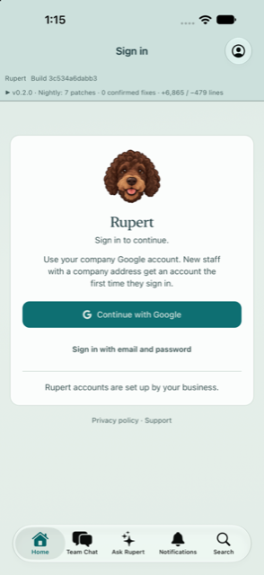
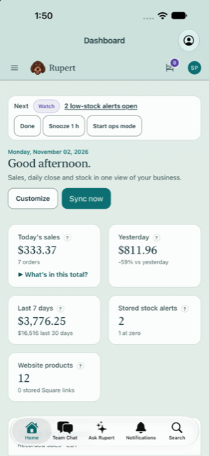
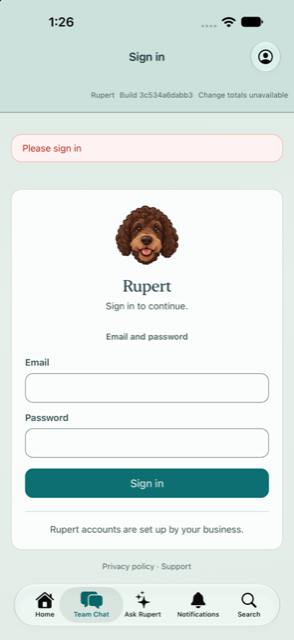
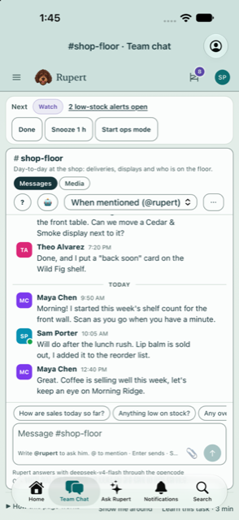
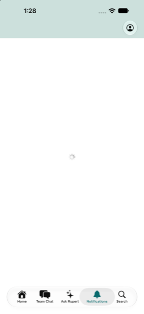
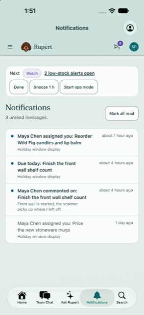
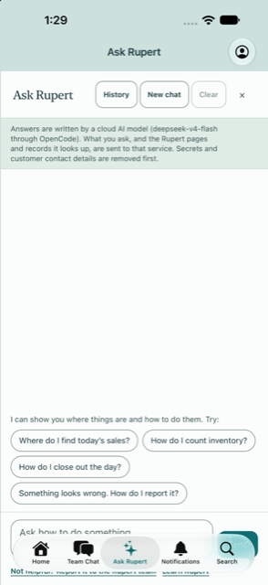
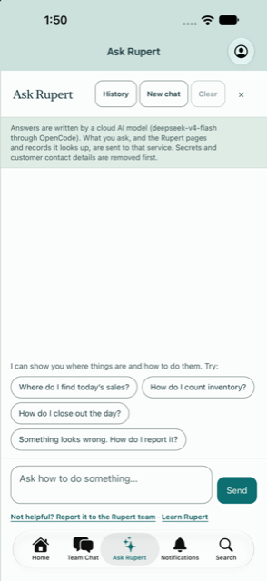

# Rupert for iPhone and iPad: App Review and partner readiness

**App:** Rupert: Shop Back Office · version 1.0 · Apple ID 6826466832 · bundle `com.rupertpos.Rupert` ·
source `ios/` (Hotwire Native 1.3.1 around `pos.rupertpos.com`). Status in App Store Connect:
Waiting for Review since 2026-10-29.

**Reviewed:** 2026-11-02, against the App Review Guidelines (page dated 2026-10-16), on Xcode 27.2
with the iOS 27.2 simulator (iPhone 18 Pro Max, iPad Pro 13-inch). Signed-out screens were checked
against production. Signed-in screens were checked against a local Rupert seeded with the fictional
App Review shop (`rupert:app_review_demo`). Nothing was submitted to Apple and nothing in App Store
Connect was changed.

`mobile/` (the Expo "Rupert Employee" timesheet app, `org.stoverparc.rupert.employee`) is a
separate app and is not the one in review.

## Summary

The app is in good shape: account deletion, privacy and support links, usage strings, a privacy
manifest, no tracking, no in-app purchases, a demo shop and review notes were already in place.
The review found **four bugs a reviewer is likely to hit**. All four are fixed on this branch:

1. The Home Screen quick actions, which the review notes ask Apple to try, opened an endless spinner.
2. Tabs did not follow a sign-in or sign-out.
3. The first screen showed a "Nightly: 7 patches · 0 confirmed fixes" strip.
4. The floating tab bar hid Ask Rupert's Send button.

Two items need the owner: **explicit permission before Ask Rupert sends data to a cloud AI**
(guideline 5.1.2(i)), and **the age-rating answers** (the hemp, vape and THC catalogs of real
merchants are visible in the app).

**The build now in review does not contain the native fixes.** The server fixes take effect for
that build as soon as they are deployed. The quick-action and tab fixes need a new binary (see
[Decide what to do with the build in review](#decide-what-to-do-with-the-build-in-review)).

## Ranked findings

| # | Risk | Guideline | Finding | Status |
|---|---|---|---|---|
| 1 | **High** | 2.1 (completeness, bugs) | **Quick actions opened an endless spinner.** Choosing Team Chat, Ask Rupert, Notifications or Search from the icon menu selected the tab but never loaded it, because lazily loaded tabs only start when the tab bar is tapped. Review notes step 3 asks the reviewer to do exactly this. | **Fixed** (native, new build) |
| 2 | **High** | 2.1, 5.1.1 | **Tabs did not follow sign-in or sign-out.** After signing in on Home, a tab opened earlier still said "Please sign in", and Home kept a back arrow to the sign-in page. After signing out, the other tabs kept showing business pages. Reviewers tap the tabs before signing in. | **Fixed** (native + server) |
| 3 | **High** | 2.2 (betas don't belong on the App Store), 2.1 | **Build strip on the first screen:** "Rupert Build 3c534a6dabb3 ▸ v0.2.0 · Nightly: 7 patches · 0 confirmed fixes · +6,865 / −479 lines". This reads as a nightly or beta build. | **Fixed** (server; applies to the build in review once deployed) |
| 4 | **High** | 5.1.2(i) (explicit permission before sharing personal data with third-party AI) | **Ask Rupert and @rupert in Team Chat send the question, and the records the AI looks up, to a cloud model (DeepSeek through OpenCode).** The panel discloses this, but nobody is asked for permission first. | **Owner decision** (see [AI permission](#ai-permission-5121)) |
| 5 | Medium | 2.1, 4.0 | **Ask Rupert's question box and Send button sat under the floating tab bar** on iPhone, so Send was partly hidden. | **Fixed** (native + server) |
| 6 | Medium | 2.3.6 (honest age rating), 1.4.3 | **Age rating "4+, None for drugs" does not match real merchants.** Herbal Healers' catalog (THCA flower, vapes, THC gummies) appears in the app's catalog, sales and POS pages. | **Owner** in App Store Connect (see [Age rating](#age-rating-and-hemp-cbd-catalogs)) |
| 7 | Medium | 2.1 (crash) | **`NSPhotoLibraryAddUsageDescription` was missing.** Touching and holding an image in a page offers to save it to Photos. iOS stops apps that write to the photo library without this key. | **Fixed** (Info.plist, new build) |
| 8 | Medium | 4.2 (minimum functionality) | The app is a web-view shell with native extras: camera barcode scanning, Face ID lock, native settings, quick actions, a native tab bar and the Google sign-in sheet. This is the usual reason web-wrapper apps get rejected. | Unchanged. The answer is ready in `ios/AppStore/checklist.md`. Push notifications are the next native feature if Apple pushes back. |
| 9 | Medium | 2.1 (demo account) | The demo login could not be checked on production: the password is the owner's. The demo data's dates go stale after the 30 sample days. | **Owner** (see [App Store Connect steps](#what-the-owner-does-in-app-store-connect)) |
| 10 | Low | 4.8 (login services) | "Continue with Google" also **creates** accounts for new staff with a company address. The exception for business apps that require an existing business account applies, and the review notes already say so. | No change; keep the note |
| 11 | Low (security) | n/a | **Safari Web Inspector was enabled in release builds** (`isInspectable = true`). Anyone with the unlocked device and a Mac could read pages and session cookies. | **Fixed** (debug builds only) |
| 12 | Low (security) | n/a | The workspace handoff trusts the `origin` in any `rupert://workspace` link that reaches the web view. A crafted link inside a Rupert page could move the app's tabs to an outside site, which the app would then treat as Rupert. | **Recommended** (see [Partner readiness](#partner-readiness-valmar-dejavoo-merchants)) |

Checked with nothing to fix:

- **Account deletion (5.1.1(v)):** App settings → Delete account, and the account menu → Delete my account (`/account/delete`, `AccountDeletion`).
- **Privacy policy (5.1.1(i)):** linked in App Store Connect, on the sign-in page and in App settings. It opens inside the app.
- **No digital goods (3.1.1, 3.1.3(c)):** Billing is hidden and refused in the app (`BillingController#refuse_in_native_app`). Sign-up is hidden in the app. No page in the app links to the priced marketing site (rupertpos.com). Card payments on web pages are for physical goods (3.1.3(e)).
- **Usage strings:** camera, photos, microphone and Face ID. Bluetooth and location are not used: barcode scanners act as keyboards. No App Tracking Transparency is needed, because there is no tracking.
- **Export compliance:** `ITSAppUsesNonExemptEncryption = NO` is correct. The app uses HTTPS through the system, plus SHA-256 for the PKCE challenge, which are both exempt.
- **Privacy manifest:** `UserDefaults` CA92.1 is declared. Hotwire Native uses no required-reason APIs.
- **Launch:** no crash on launch on iPhone or iPad. The iPad layout is the website's own responsive layout (see `screenshots/ipad-signin.png`).
- **Release build:** compiles clean under Xcode 27.2.

## What changed on this branch

**Native (`ios/`, needs a new build):**

- `SessionWatcher.swift` (new): every page in the app now carries `<meta name="rupert-session">`. When a page reports a sign-in or sign-out, the app starts every tab over on its first page. This drops old back stacks and cached pages. The restart waits for the old page to finish its visit; doing it inside that callback left the new Home tab blank in release builds.
- `SceneController.swift`: quick actions now start the tab they select, and so do the Google sign-in and workspace-handoff paths.
- `Banner.swift`: each page gets `--native-bottom-inset`, the height of the tab bar.
- `AppDelegate.swift`: Web Inspector is on in debug builds only.
- `Info.plist`: `NSPhotoLibraryAddUsageDescription`.
- `Tests/RupertTests` (new, 12 tests): the session state machine, the inset script, Rupert's own sites and origins, and the Info.plist privacy keys. Run them with `cd ios && xcodebuild test -scheme Rupert -destination 'platform=iOS Simulator,name=iPhone 17'` (any iOS 17+ simulator).

**Server (`web/`, takes effect on deploy):**

- In the app, the build strip is not shown on signed-out pages, and the account menu shows the build without the nightly totals. Browsers are unchanged, and the `X-Rupert-Build` header stays everywhere.
- `layouts/application.html.erb`: adds the `rupert-session` meta tag, for the app only.
- `application.css`: in the app, the Ask Rupert panel is padded by `--native-bottom-inset`. The fallback is 0, so the build in review is unaffected.
- `test/integration/native_app_review_test.rb` (5 tests). The 23 native and build-version tests pass. The full suite: 3,752 runs with 2 failures, both host-specific and unrelated to these files. `HostVitalsTest` reads Linux `/proc`, and `PlatformTest` hits a macOS string-encoding difference.

Before and after (fictional demo shop):

| Before | After |
|---|---|
|  |  |
|  |  |
|  |  |
|  |  |

Also in `screenshots/`: App settings, the privacy policy in the app, the quick-action menu and iPad sign-in.

## Decide what to do with the build in review

The build in review has bugs 1, 2, 5 and 7. Bug 1 sits on the review notes' own path.

- **Recommended:** deploy the server changes now. Then remove the build from review in App Store Connect (developer reject), build and upload a new binary from this branch, and resubmit with the updated notes. This costs a place in the queue but avoids a likely 2.1 rejection.
- **Alternative:** deploy the server changes and let the current review run. If it is rejected for quick actions or tabs, reply in Resolution Center and send the new build.

## What the owner does in App Store Connect

1. **Demo account (2.1).** On production, run `REVIEW_PASSWORD='…' REVIEW_DEMO_RESET=1 bin/rails rupert:app_review_demo` right before (re)submitting, so the 30 days of sample sales end today. Then sign in once on a phone as `appreview@rupertpos.com` and confirm three things:
   - Ask Rupert answers.
   - **Sync now** on the Dashboard does not show an error for the demo shop. This was not checked: the demo shop has no real Shopify or Square connection.
   - The draft inventory count opens.
2. **Review notes.** Paste the updated notes from `ios/AppStore/review-notes.md`. They now describe Ask Rupert's AI and that the data is fictional.
3. **Age rating.** Re-answer the questionnaire as described [below](#age-rating-and-hemp-cbd-catalogs).
4. **App Privacy (nutrition label).** Keep the answers in `ios/AppStore/checklist.md`. "Other User Content" covers Ask Rupert questions. The AI provider processes data for Rupert, which is not tracking. **Name the AI provider in the privacy policy:** today it says "the AI providers we route to". Name DeepSeek through OpenCode, or whichever provider is configured.
5. **Export compliance:** nothing to do (`ITSAppUsesNonExemptEncryption = NO`).
6. **Do not** change the bundle ID, and do not offer sign-up or prices in the app.

## AI permission (5.1.2(i))

Apple's November 2025 update to 5.1.2(i) asks apps to disclose where personal data goes, **naming third-party AI**, and to get **explicit permission before** sharing it. Rupert shows the disclosure at the top of the Ask Rupert panel, but the first question is sent without asking. Team chat's @rupert has the same gap. The question and the records the AI looks up (sales, customers with contact details removed, staff hours) are personal data under Apple's reading.

This branch does not change it, because it changes the AI flow for every user. Recommended design:

- A one-time **Allow** step in the Ask Rupert panel (and before the first @rupert in chat). It names the provider and what is sent, with **Allow** and **Not now** buttons. Store it per person, for example `users.ai_consented_at` plus the provider name, and ask again when the provider changes.
- Refuse cloud turns server-side (`AskRupertController#ask`, `TeamChat::Agent`) until the person has agreed. `local_only` mode needs no permission.
- Add a way to withdraw permission (App settings or the account menu), as 5.1.1(i) asks.

## Age rating and hemp/CBD catalogs

- **1.4.3** (quoted): "Facilitating the sale of controlled substances (except for licensed pharmacies and licensed or otherwise legal cannabis dispensaries), or tobacco is not allowed." Hemp and CBD are not named. Rupert is a back office and point of sale for the merchant's own staff. It does not sell to consumers or encourage consumption, so the app itself is acceptable.
- **The catalog changes the picture for Herbal Healers.** The shared federal review (2026-11-02) finds about 38 of its 47 products (THCA flower, vapes, THC gummies and drinks) stop being federal "hemp" on **2026-12-11**. After that date, ringing them up in the app is closer to "facilitating the sale of controlled substances". That is a merchant-compliance matter for counsel, and the ring-up guardrails from F70 help. Apple only sees it if it looks at a real merchant.
- **What to do:**
  - Keep the review demo, the listing and the screenshots free of hemp, CBD, vape and THC. They are today.
  - Never describe the app as "for CBD or dispensary shops".
  - If Rupert is ever marketed for licensed cannabis sales, 5.1.1(ix) requires the app to come from the licensed entity and to be geo-restricted.
- **Age rating (2.3.6):** "None" to drug references is not honest for a POS that lists vapes and THC products. Answer **Alcohol, Tobacco, or Drug Use or References: Infrequent**, which gives **13+** under Apple's current tiers, and **Messaging and chat: Yes** (private team chat). If hemp and vape shops become the main customers, set **18+**. It costs nothing for a staff app.

## Partner readiness (Valmar, Dejavoo, merchants)

- **Card data never touches the app.** The app has no card reader, NFC (Tap to Pay) or terminal SDK. Card entry exists only on web pages that use the processor's hosted fields:
  - Authorize.net Accept.js hosted fields on the warehouse checkout.
  - NMI Collect.js, which is sandbox-only; `nmi_fields.js` refuses production.

  The app's own scripts are injected into the main frame only (`forMainFrameOnly: true`), so they never run inside the payment iframes. App and server scope for PCI DSS follows the web pages: SAQ A or A-EP depending on the hosted-field product. Confirm the exact SAQ with the processor or QSA. **For Dejavoo:** keep card-present payments terminal-to-processor (Rupert sends the amount to the terminal and gets back a result or token). The app then stays out of scope.
- **Tokens and storage.** The app stores no API tokens or passwords.
  - The Rails session cookie (encrypted cookie store, 14 days, `valid_browser_session?` checked on every request) lives in the system web data store, in the app's container, under iOS Data Protection.
  - Google sign-in uses PKCE. The verifier is held in memory only, and the one-time code is exchanged over an ephemeral `URLSession`. The workspace handoff also uses an ephemeral session.
  - `UserDefaults` holds the instance address, the Face ID setting, whether the notification question was answered, and the digest and host of the push registration (cleared on sign-out and on Switch workspace). No token or password.
  - No Keychain use is needed today. **If the app ever holds a token** (terminal pairing, API keys), use the Keychain with `kSecAttrAccessibleWhenUnlockedThisDeviceOnly`.
- **Transport.** HTTPS only: there are no App Transport Security exceptions, the app refuses non-HTTPS instances, and the control plane is fixed in `Info.plist`. Other sites open in an in-app Safari view, not the app's web view. There is no certificate pinning, which is normal for a web-content app. Web Inspector is now debug-only.
- **Workspace handoff (finding 12), partly done 2026-11-10.**
  - Done: the app accepts `rupert://workspace` only when `control` is its own control plane (`RupertControlPlaneURL`); anything else is refused with a message.
  - Still to do: accept it only as the server's redirect (not a tapped link), or have the server sign the origin.
  - Test it against a real isolated workspace before shipping.
- **Shared phones and second workspaces (2026-11-10).** Settings → **Switch workspace** signs out, forgets the push token on the server, clears the web views' data and returns to the control plane. A push token registers to one account across all workspaces, the server forgets it without a session, and a notification opens only a path on the current instance. See `docs/audits/2026-11-10-time-multi-tenant-audit.md`.
- **AI vendor.** Partners and merchants will ask where business data goes. Ask Rupert's default is a cloud model (DeepSeek via OpenCode). Have the answer ready: the provider, its retention, and the `local_only` mode that keeps questions on the Rupert server.
