# iPhone app: UI/UX pass, 2026-11-02

A review of the native parts of Rupert for iPhone (`ios/`): first run and sign-in, tabs, sheets,
error states, App settings, the app lock, the barcode scanner, Dynamic Type, VoiceOver and haptics.
It builds on the App Review readiness work (`docs/ios/app-review-readiness.md`, PR #617), whose
changes are kept as they are.

**How it was checked.** The app was built from this branch with Xcode 27.2 and run in the iOS 27.2
simulator (iPhone 18 Pro) against a local Rupert on `https://localhost` with the fictional App
Review shop (`rupert:app_review_demo`). Screens were captured in light and dark mode and at the
Large, Accessibility XL and Accessibility XXXL text sizes. Nothing touched production, App Store
Connect or any Shopify or Square store. The 16 unit tests in `ios/Tests` pass.

## Findings

| # | Severity | Area | Finding | Status |
|---|---|---|---|---|
| 1 | High | First run | Signed out, all five tabs showed the same sign-in page, four of them under a red "Please sign in" error. | **Fixed**: the tab bar hides while signed out; only Home's sign-in page shows. |
| 2 | High | Sheets | Form sheets (`/new`, `/edit`) had a green ✓ "Done" that read as *save* but closed the sheet and dropped the form. A swipe down did the same, silently. | **Fixed**: Cancel on the left; after any edit, Cancel and the swipe ask "Discard Changes". |
| 3 | High | Dark mode | Rupert's appearance is chosen in the account menu and never follows the phone. On a dark phone the tab bar, keyboard, sheets and loading screens turned dark (black loading screens between two light pages). | **Fixed**: the native chrome follows the page's appearance. |
| 4 | High | Dynamic Type | Pages ignored the iPhone's text size; at the largest sizes only the native title and tab labels grew. | **Fixed**: pages scale with the text size (85–150%) and still reflow. |
| 5 | High | App lock / VoiceOver | The lock cover was a plain subview: VoiceOver could still read and activate the pages under it, and an alert opened while locked could appear above it. | **Fixed**: the cover is its own window above alerts, accessibility-modal. |
| 6 | Medium | App lock / Dynamic Type | At large text sizes "Rupert is locked" and "Unlock with Face ID" ran off both edges of the screen. | **Fixed**: wraps within readable margins, scrolls at the largest sizes. |
| 7 | Medium | Error states | Every failure showed Hotwire's "Error loading page" with a small Retry link. Nothing retried when the phone came back online. A page whose JavaScript did not start showed an alert with the user agent and import map on top of the error page. | **Fixed**: plain-words pages per failure (offline, can't reach Rupert, too slow, no access, not found, Rupert had a problem), a Try Again button, automatic reload when back online, diagnostics behind "Copy Details for Support". |
| 8 | Medium | Navigation | Leaving Team Chat, the chat script set `document.title` back to the chat's title after Turbo had loaded the next page: every page opened from chat was titled "#shop-floor · Team chat", in the app's bar and in browser tabs. | **Fixed** (web JS, with a test). |
| 9 | Medium | Instance onboarding | Once a customer opened their isolated workspace, the app stayed on it for good. App settings showed the host but no way back, short of deleting the app. | **Fixed**: "Switch Workspace" in App settings. Not exercised locally (the demo shop has no isolated workspace). |
| 10 | Medium | Scanner | The first scan checked `DataScannerViewController.isAvailable` before the app had asked for the camera, so it could send someone to Settings for a permission they were never asked for. A camera that failed to start left a black screen. | **Fixed**: asks first; start failures close with a message. |
| 11 | Medium | Scanner ergonomics | No flashlight for dim stockrooms, no hint in the viewfinder, no VoiceOver feedback for the scanned code. | **Fixed**: flashlight button, hint line, announcement. |
| 12 | Medium | App lock | Face ID was asked on every return, even after a few seconds in another app at the counter. | **Fixed**: "Ask Again" setting (Immediately by default, or after 1, 5 or 15 minutes). The app switcher always shows the cover. |
| 13 | Low | App settings | "Delete account" showed on the sign-in screen. | **Fixed**: only while signed in. |
| 14 | Low | Sheets | Sheets repeated Rupert's menu bar, account button and "Next" card under the native title. | **Fixed** (CSS on deploy): hidden in sheets. |
| 15 | Low | App settings | The first open of App settings took ~30 s in the simulator: LocalAuthentication was queried on the main thread on every render. | **Fixed**: read once. On a phone this was likely milliseconds. |
| 16 | Medium | Navigation | Two account controls sit side by side on every tab's first page: the native person button (App settings) and Rupert's "SP" avatar (account menu). | **Recommended**: one entry point, e.g. add App settings to the account menu through a bridge component and drop the native button, or the reverse. |
| 17 | Medium | Navigation | Links in Rupert's menu to Team Chat, Ask Rupert, Notifications or Search push a second copy of that page on the current tab instead of switching tabs. | **Recommended**: a route handler that selects the tab for those paths. |
| 18 | Medium | Scanner | One code per camera session: counting a shelf means reopening the camera for every item. The page drops a code that arrives while the previous one is saving, so continuous scanning needs a queue on the page first. | **Recommended**: queue in `inventory_count_scanner_controller.js` (coordinate with the Android session, which edits that file), then keep the scanner open with a running count. |
| 19 | Low | Sign-in | After an email sign-in the dashboard is briefly pushed on top of the sign-in page (back arrow) until the tabs restart. | **Recommended**: have the sign-in redirect replace instead of push (`recede_or_redirect_to`, or a path rule). |
| 20 | Low | Web, large text | At large text sizes some px-sized web pieces stay small (the dashboard's Sync now button, the top bar's flag icon, which the badge then covers). | **Recommended**: rem sizes for those. |

### Navigation rules (`path-configuration.json`)

Reviewed: forms open as sheets, `/login` and `/logout` replace the stack, chat, Ask Rupert and POS
turn off pull to refresh, and Hotwire 1.3.1 adds the `*_historical_location` routes itself. The
bundled copy matches `Native::ConfigurationsController::RULES`. No rule changed here. Worth adding
later: pull to refresh off on `/inventory_counts/:id/scan` (a pull while scanning reloads the
page).

### Haptics

Kept sparing, as the HIG asks: success on a scanned code (existing), a warning when discarding a
sheet's edits, and success on "Copy Details for Support".

### Not verified

- Barcode scanning, the flashlight and the camera permission prompt: the simulator has no camera
  (`DataScannerViewController.isSupported` is false). Check on a phone.
- VoiceOver was checked in code (modal cover, header traits, announcements), not with VoiceOver
  running.
- Google sign-in, the workspace handoff and Switch Workspace: no Google client or isolated
  workspace locally.
- iPad layouts.

## Screenshots (fictional demo shop)

| | Before | After |
|---|---|---|
| Signed out (phone in dark mode after) | 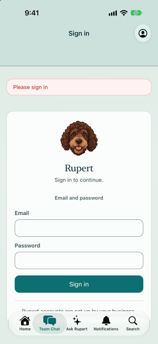 | 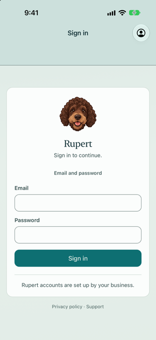 |
| Phone in dark mode, Rupert in Herbal | 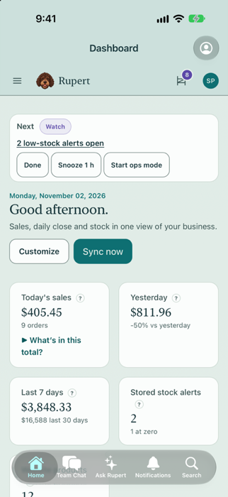 |  |
| Sign-in page, phone in dark mode / Rupert's Dark appearance | 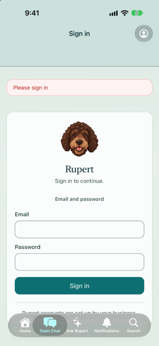 | 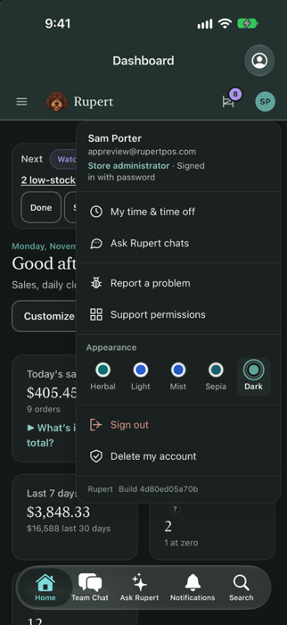 |
| Form sheet | 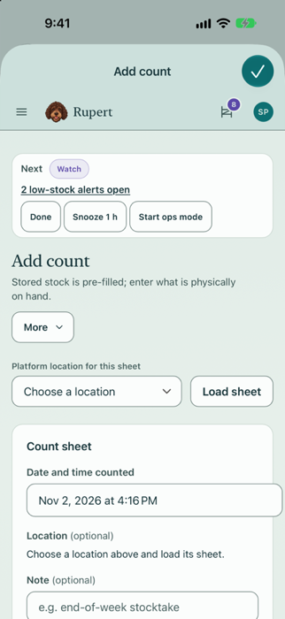 | 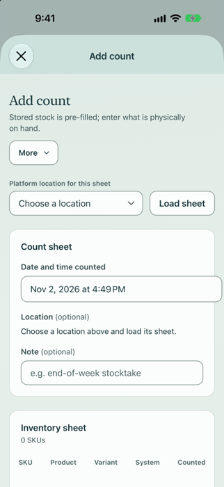 |
| Cancel after typing | (closed, edits lost) | 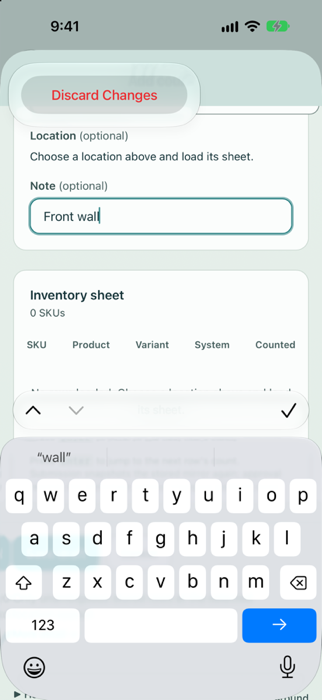 |
| Page opened from Team Chat | 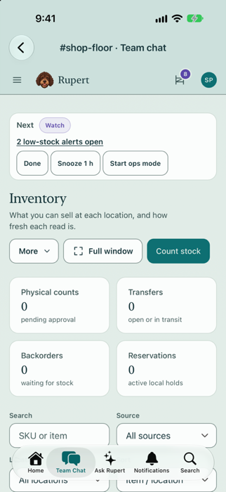 | 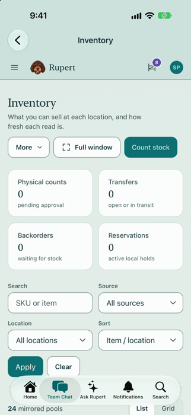 |
| Rupert unreachable | 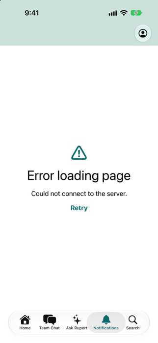 | 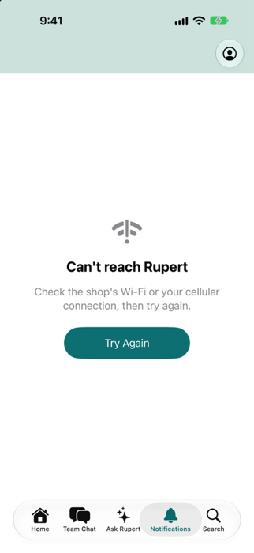 |
| Accessibility XL text | 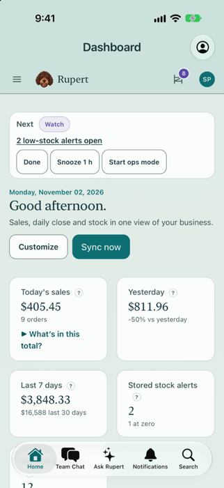 | 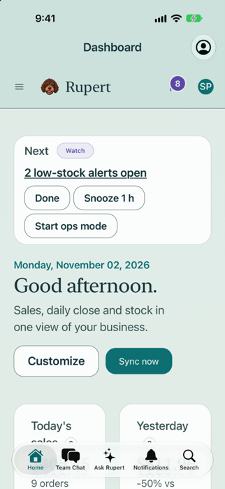 |
| Lock, Accessibility XXXL text | 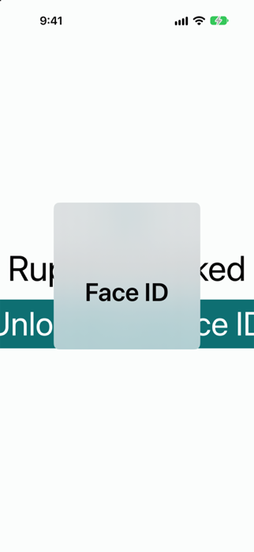 | 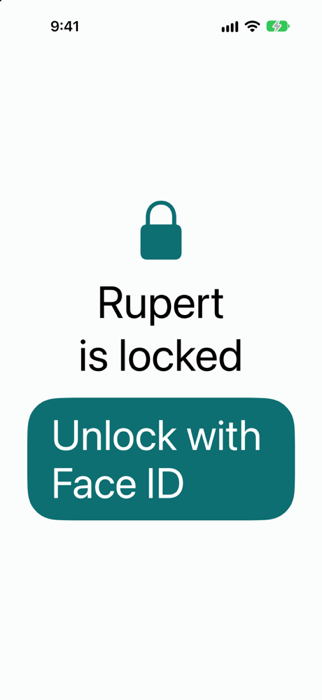 |
| App settings, signed out | 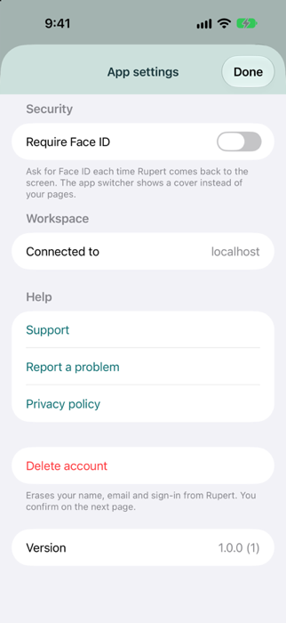 | 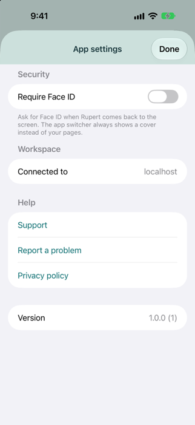 |
| App settings, lock on | | 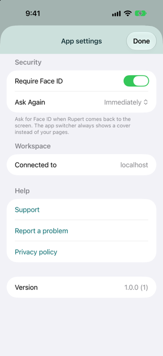 |

## Deploy notes

The native changes need a new build. Two pieces are server-side and take effect on deploy:
the sheet CSS (`application.css`, `html[data-native-modal]`) and the Team Chat title fix
(`team_chat_controller.js`). Both are harmless without the new build.
