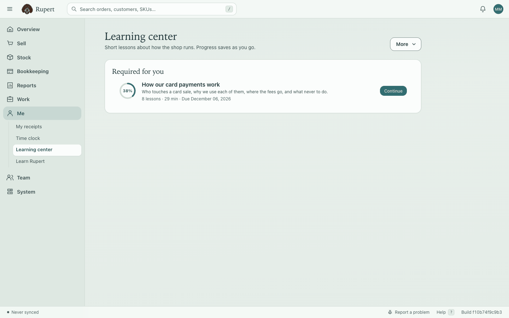
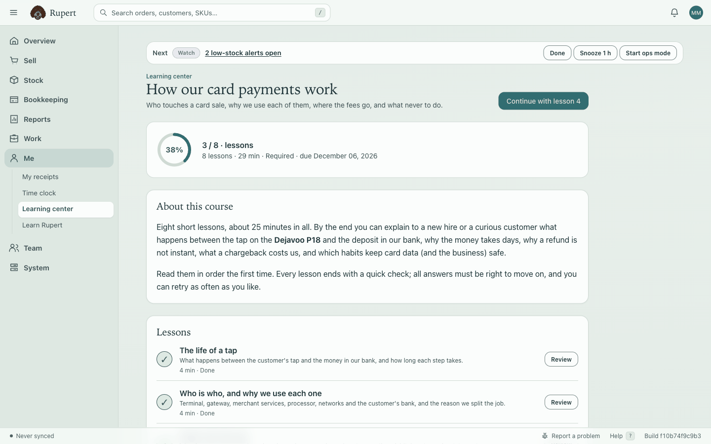
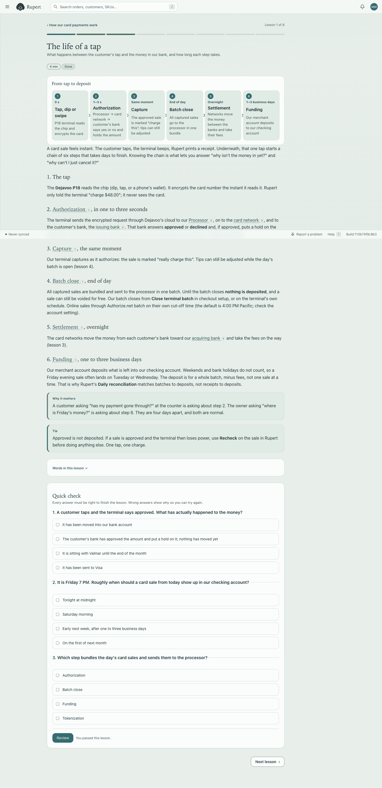
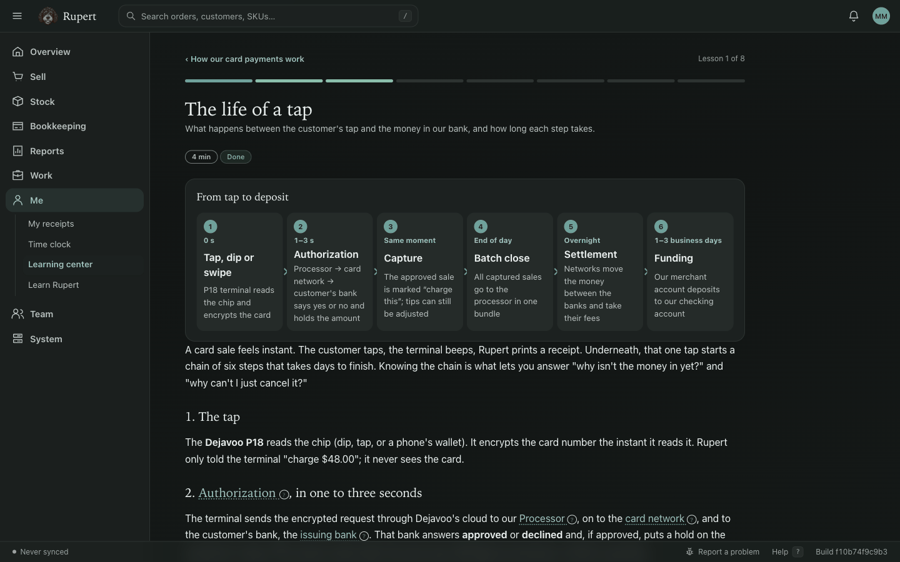
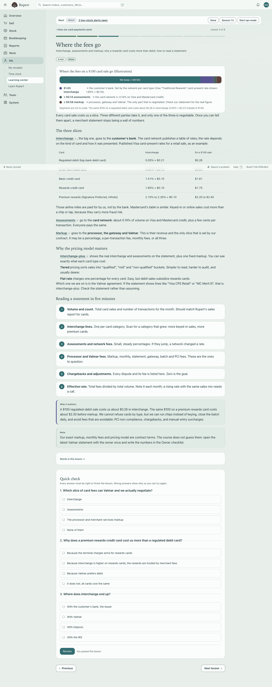
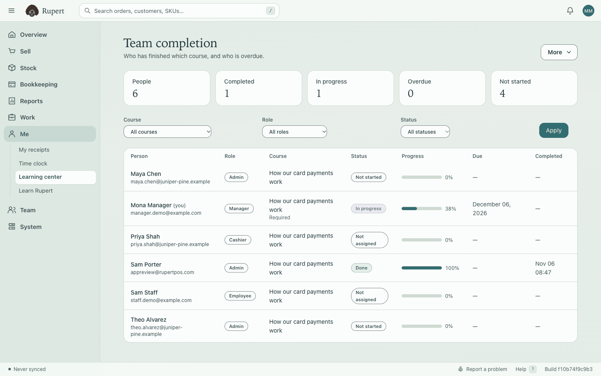
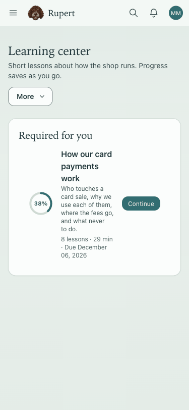
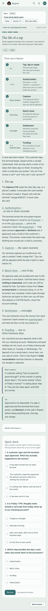
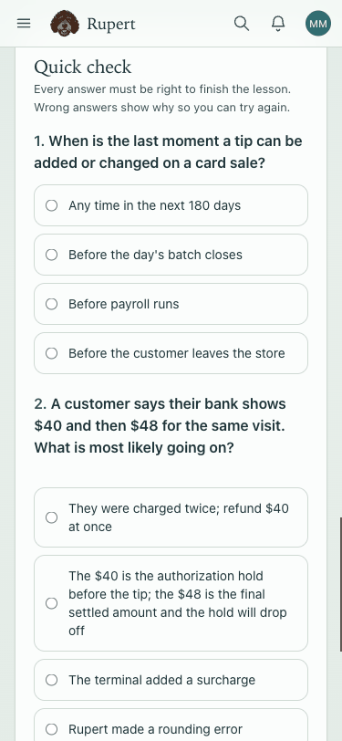
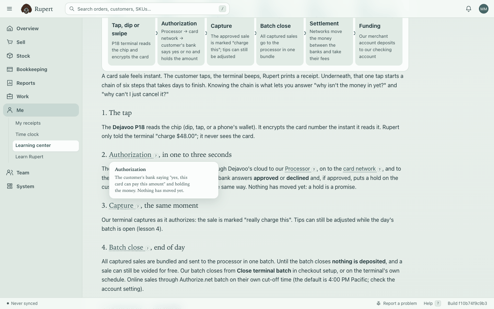

# Learning center: build report

Built 2026-11-06 on branch `feat/manager-lms`. Owner directive: a small, beautiful Learning center inside the
manager area whose first course teaches how our card processing works, built as a reusable LMS and shipped to
production. Everything below is in this branch; production status is at the end.

## What was built

**A reusable LMS.** Courses → lessons → quiz questions → glossary as workspace data (`lms_*` tables, additive
migration), with assignment rules by role (required, due within N days), named assignments by a manager, per-lesson
progress, append-only quiz attempts and a completion badge. Shipped courses are YAML files that seed themselves on
first visit; owners edit lessons, quizzes and rules in the app. Details: `README.md`, choices: `DECISIONS.md`.

**The first course: How our card payments work.** Eight lessons, 3–4 minutes each, 24 quiz questions, 27
tap-to-define words, eight diagrams. Content summary:

| # | Lesson | What a manager can do afterwards |
| --- | --- | --- |
| 1 | The life of a tap | Explain tap → authorization → capture → batch → settlement → funding and why Friday's money lands midweek |
| 2 | Who is who, and why we use each one | Name the P18, Dejavoo's cloud, Authorize.net, Valmar, the processor/acquirer, the networks and the issuer, and say which one to call; explain why the job is split (liability, cost, PCI scope, flexibility); say where Square fits today |
| 3 | Where the fees go | Tell interchange, assessments and markup apart, say why rewards cards cost more than regulated debit, read a statement in five minutes |
| 4 | Tips | Put a tip on a P18 sale, adjust it before the batch closes, explain the "charged twice" hold, say how tips reach pay |
| 5 | Refunds, voids, and why a refund is not instant | Void while the batch is open, refund after, give the customer a straight answer about timing, refuse refund-to-another-card |
| 6 | Chargebacks and disputes | Know what a dispute costs and the deadlines, keep the evidence that wins, prevent most of them at the counter |
| 7 | Security and PCI | The five "never"s (card numbers on paper, by phone or text, keyed-in workarounds, stored cards, shared credentials), terminal inspection, spotting fraud |
| 8 | When things break | Terminal offline, declines, "waiting" sales (Recheck, never re-charge), open batches, mismatched totals, who to call (from settings) |

**Where it lives.** Me → Learning center for every account (staff accounts get it in their own shell); Team
completion (`hr.read`) and Manage courses (`hr.write`) from its More menu. Spanish UI strings in `lms.es.yml`.

**Accessibility and devices.** Real HTML diagrams (reflow at 375px, read aloud, print), one `h1`, labelled
landmarks, keyboard-operable popovers with Escape, 44px targets, reduced motion honoured, every colour from the
appearance tokens (Herbal, Light, Mist, Sepia, Dark). The iOS app (Hotwire Native) renders the same pages; no
native change was needed.

## Screenshots

| | |
| --- | --- |
|  |  |
|  |  |
|  |  |
|  |  |
|  |  |

## Tests

`web/test/services/lms/` (markup rendering and escaping, quiz grading, progress and completion, assignment rules
and tightening, seeding and re-seeding) and `web/test/integration/lms_flow_test.rb` (learner flow to badge, staff
shell, team permissions and CSV, admin editing, preview escaping, rule and manual assignment, support contacts,
drafts, tenant isolation). RuboCop clean on new files; Brakeman adds no finding for the new code; the
product-site and link checks pass.

## Sources

`SOURCES.md`. Two facts from the brief were corrected by the sources: Authorize.net refunds are allowed for
**180** days after settlement (not 120), and the default cut-off is **4:00 PM Pacific** on the support site (one
help page says 3:00 PM; the course says to check the account).

## Open questions for the owner

`OPEN-QUESTIONS.md`: Valmar pricing and fees, which SAQ applies, whether the P18 is boarded through Authorize.net
or straight to the processor, batch auto-close and tip prompt choice, support contacts, any Square reader still in
use, home locations for accounts, who should be required.

## Production status

**Live on SER8 since 2026-11-06 14:22 UTC** (`main` `1750f0ab`, PR #643), healthy per the updater receipt,
`/up/ready` and the web journal; the course is seeded in the Herbal Healers workspace and managers are enrolled
(required, due in 30 days) when they first open **Me → Learning center**. Details and the backup used are in
`DEPLOYS.md`. A signed-in walk through a lesson on production is the owner's first visit.
