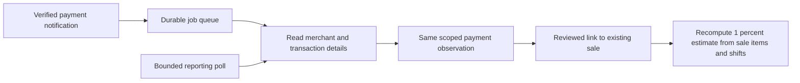

# Authorize.net API investigation and Rupert implementation record

Reviewed **October 15, 2026**, against official documentation, the live public XML schema and Rupert code `06f08218eb57379910409c78323b18f5bcda083f`. This record covers API authentication, reporting, payment lifecycle, notifications, matching and operation; it does not claim exhaustive verification of every processor or product.

**Operational decision: live Authorize.net setup and syncing remain paused by the owner.** This investigation authorizes no reactivation, key generation, merchant configuration change or payment operation. Research used public documentation and local code; it made no authenticated merchant API requests. No credentials, merchant usernames, Gateway IDs, transaction exports, cookies or verification codes are committed here.

The earlier merchant sign-in reached an emailed-PIN challenge. That was an interactive account-access step, not evidence that every reporting API request requires a PIN. The last pause verification found no configured Authorize.net reporting connection and no active sale matches. Historical observations are not a new live-state check.

## 1. API access and portal access are separate

| Mechanism | Purpose | Human interaction / limitation |
| --- | --- | --- |
| Merchant username, password and verification PIN | Interactive Merchant Interface access | Needed when the portal requires identity verification; not the reporting client's authentication contract. |
| API Login ID + existing Transaction Key | Server authentication for supported gateway methods | No per-request portal PIN field. The key can also process payments; a read-only application wrapper does not make it a read-only credential. |
| OAuth access token with `read` scope | Merchant-authorized API reporting | Partner application registration and owner/admin consent are prerequisites. Consent may require interactive login; subsequent server requests use the token. Revocation/expiry can require operator intervention. |
| Signature Key | Authenticate inbound notifications | Not an API Login ID, Transaction Key or OAuth token. |
| Public Client Key | Browser-side Accept tokenization | Not server reporting authentication or proof that a payment succeeded. |

The existing Transaction Key is not redisplayed by the portal after its creation. Retrieve an existing integration key from its authorized checkout operator or secure record. Replacement Transaction/Signature Keys invalidate previous keys immediately if selected, otherwise after the documented overlap period of 24 hours. Inventory every dependent checkout/callback before any separately authorized rotation. API account IDs and merchant website usernames are different identities. [Official credential guidance](https://support.authorize.net/knowledgebase/article/000001271/en-us).

OAuth registration occurs in the Partner Interface; it is not established merely by having a merchant login. Registration supplies a client ID/secret and exact redirect URL. The merchant grants requested scope, the application validates `state`, exchanges the short-lived authorization code, and retains refresh credentials encrypted. Rupert implements refresh of an existing grant, not the initial registration/consent/code-exchange flow. [OAuth developer guide](https://developer.authorize.net/api/reference/features/oauth.html).

Authorize.net's merchant support documents `read` and `read,write`, with consent limited to owners/administrators. The developer guide says access tokens last one hour, while both classic and new merchant articles say ten minutes; developer example lifetimes also differ. Treat issued token metadata and actual expiry/revocation responses as authoritative rather than hard-coding one lifetime. Rupert refreshes for each reporting operation and requires exactly the returned `read` scope. Confirm refresh rotation and granted scope against a real approved application before rollout. [Classic permissions](https://support.authorize.net/knowledgebase/article/KA-07428/), [new experience permissions](https://support.authorize.net/knowledgebase/Knowledgearticle/?code=KA-07620).

## 2. Protocols and environments

| Surface | Production | Sandbox | Authentication |
| --- | --- | --- | --- |
| JSON/XML gateway API | `https://api.authorize.net/xml/v1/request.api` | `https://apitest.authorize.net/xml/v1/request.api` | `merchantAuthentication` in the request body |
| OAuth token endpoint | `https://access.authorize.net/oauth/v1/token` | `https://accesstest.authorize.net/oauth/v1/token` | URL-encoded grant/client fields |
| Webhooks management REST API | `https://api.authorize.net/rest/v1` | `https://apitest.authorize.net/rest/v1` | Documented Basic API Login ID/Transaction Key authentication; OAuth guide also describes Bearer authentication for REST, but read-only tokens must not be assumed to authorize subscription writes |

The gateway API uses named requests over HTTPS POST, not a guessed REST `/transactions` resource. JSON and XML represent the same contract. Use schema-compatible element names/order and check application messages as well as HTTP status. A successful transport response is not proof of an approved payment. The public schema is [AnetApiSchema.xsd](https://api.authorize.net/xml/v1/schema/AnetApiSchema.xsd); its `/v1/` path is not a promise that fields never change. [Payment API guide](https://developer.authorize.net/api/reference/features/payment-transactions.html), [API reference](https://developer.authorize.net/api/reference/index.html).

Sandbox accounts and credentials are separate. Sandbox Live Mode stores simulated transactions; gateway Test Mode can return a zero transaction ID without durable transaction records. Therefore a Test Mode checkout response is unsuitable evidence for reporting/webhook reconciliation. No production mode was changed during this investigation. [Official sandbox/testing guide](https://developer.authorize.net/hello_world/testing_guide.html).

Reporting, OAuth registration, browser payment forms and partner/processor-specific offerings are different surfaces. Do not substitute similarly branded `developer.plus.authorize.net` report endpoints or SOAP examples into this JSON/XML connector without separately verifying product entitlement, authentication and schema.

### Non-executed reporting template

POST this shape only after a separately authorized resume, with credentials entered through encrypted configuration. Angle-bracket placeholders intentionally make this a template, not a usable credential or real transaction sample.

```json
{
  "getTransactionDetailsRequest": {
    "merchantAuthentication": {
      "name": "<API_LOGIN_ID>",
      "transactionKey": "<EXISTING_TRANSACTION_KEY>"
    },
    "transId": "<EXISTING_TRANSACTION_ID>"
  }
}
```

For an approved OAuth grant, replace the authentication contents with `accessToken`; do not send both authentication modes. Refresh requests use form encoding and `grant_type=refresh_token`, `client_id`, `client_secret`, and `refresh_token`. Secrets must stay out of command history, diagnostic output, URLs and public fixtures.

## 3. Reporting methods and coverage

| Method | Role | Rupert implementation |
| --- | --- | --- |
| `getMerchantDetailsRequest` | Verify Gateway ID and inspect merchant configuration/currencies | Implemented and checks the configured account identity before import. |
| `getSettledBatchListRequest` | Enumerate batches in a settlement-date window | Implemented with statistics; this is a gateway settlement view, not a bank feed. |
| `getTransactionListRequest` | Enumerate summaries for a batch | Implemented with paging; batch membership is retained when details omit a batch block. |
| `getUnsettledTransactionListRequest` | Enumerate current unsettled transactions; supports a held-approval filter | Normal unsettled reads implemented. Separate fraud-management actions are not enabled. |
| `getTransactionDetailsRequest` | Retrieve current detail for an ID | Implemented using `transId`; targeted callbacks use the same independent reporting client. |
| `getBatchStatisticsRequest` | Statistics for one batch | Not separately called; batch-list statistics are imported. |
| `getTransactionListForCustomerRequest` | Transactions associated with customer/payment profiles | Not implemented or needed for the present reconciliation loop. |

The feature overview documents these reporting families; the schema determines exact request and response fields. The legacy Transaction Details help page describes an account-level enablement setting, but visibility and entitlement in this account's current interface are unverified. A portal report download is not an API entitlement test. [Reporting overview](https://developer.authorize.net/api/reference/features/transaction-reporting.html), [Transaction Details account help](https://account.authorize.net/helpCP/Account/Settings/Security_Settings/transaction_details_api.htm).

The reference limits settlement-date queries to an inclusive interval of at most 31 days. Explicit `Z` timestamps avoid merchant-timezone defaults; a last date at midnight has special whole-day inclusion behavior. It also documents a historical lower bound of January 1 two years before the current year. This is different from a rolling 730-day retention promise. Persist local evidence and arrange older exports rather than assuming indefinite source history. [Reporting reference](https://developer.authorize.net/api/reference/index.html#transaction-reporting-get-settled-batch-list), [merchant history/archive guidance](https://support.authorize.net/knowledgebase/article/000001550/en-us).

Paging `limit` is 1–1,000 and `offset` is a **one-based page number**, not a row offset; the schema permits page numbers up to 100,000. Rupert intentionally stops at 100 pages per list and 20,000 unique detail reads per import. Its default is a seven-day settlement overlap plus all previously observed nonfinal IDs. It validates first-page totals and rejects duplicate/incomplete page sequences. Source lists can change mid-read; retrying is safer than silently accepting a truncated ledger.

An unseen void/decline that already left current lists can still be missing. Following known pending IDs helps but is not a complete event archive. Backfills longer than the overlap need explicit bounded windows. No universal numerical reporting rate limit was established in the official sources reviewed; ask the vendor for this account's limits instead of inventing a requests-per-second guarantee.

## 4. What the detail schema actually contains

The downloaded schema is **212,164 bytes**, SHA-256 `c9c76cdbeba1f030bb453cdeec963457b9f85c6799db9b3888b0ade1a635a1fa`, matching the earlier investigation's fingerprint. The derived [machine-readable inventory](../data/authorize-net-api-evidence.json) records all 53 top-level elements whose names end in `Request`, plus selected contract field names/types. It contains no merchant responses. The public schema download remains in local research scratch; this repository retains the derived inventory and source URL.

| Field / group | Meaning for this integration |
| --- | --- |
| `transId`, optional `refTransId` | Native payment identity and an original/reference transaction when supplied. Refund references must stay in the same tenant/environment/Gateway ID scope. |
| Submission times, status, type, optional batch | Submission and settlement are distinct clocks. Neither supplies a clock-shift interval or guarantees the exact capture execution instant. |
| `authAmount`, `settleAmount` | Exact decimal source amounts with up to four fractional digits. These are not automatically merchandise-only or net bank amounts. |
| Optional `order.invoiceNumber`, description, purchase-order reference | Possible correlation evidence. Rupert retains only the invoice reference, encrypted. It does not parse arbitrary descriptions or purchase-order fields. |
| Optional `lineItems`, tax, shipping, duty, discount | Item/amount detail is allowed by the API. Current Rupert reporting does not import it; actual completeness, quantity semantics and processor population must be verified before using it as a commission base. |
| Optional `employeeId` | A source-provided reference, not verified employee identity or a time-clock allocation. It is not imported. |
| Optional tip and surcharge | Preserved when returned. Missing stays unknown. Customer surcharge is not merchant processing fee. |
| Optional network transaction references | Network provenance; not interchangeable with a Shopify Payment ID, gateway `transId`, or business order number. Not imported. |
| Batch statistics including refund/chargeback/returned-item aggregates | Helpful controls; not automatically a per-sale refund allocation or net bank receipt. Returned allowlisted statistics are preserved. |
| Currency | Detail has no per-transaction currency member in the reviewed type. Rupert infers only when merchant configuration has exactly one currency; multiple/unknown currencies cannot be matched. |

The detail request schema also permits `transrefId` instead of `transId`, and the response can include `transrefId`. The reference describes a merchant-assigned request reference. It is **not verified** as a stable unique business-sale lookup in this merchant integration, and Rupert neither queries nor stores it. Do not equate request correlation, webhook `merchantReferenceId` and a native payment ID without demonstrating their relationship.

The schema does not expose a verified per-payment processing-fee/net-payout contract for this connector. Processor statements, NAB/IRIS funding evidence and bank statements remain separate layers. Never compute bank deposits by summing gateway charges and ignoring fees, reserves, refunds or funding delays.

## 5. Payment lifecycle and other API families

Authorization reserves capacity; capture queues the amount for settlement; settlement precedes bank funding. `authOnlyTransaction`, `authCaptureTransaction`, `priorAuthCaptureTransaction`, `captureOnlyTransaction`, `voidTransaction` and `refundTransaction` are payment operations under `createTransactionRequest`. Reporting must not call them. A fraud-held, declined or authorization-only transaction is not proof that an order is paid. A refund is a separate source transaction whose reference must be retained. [Payment lifecycle and transaction types](https://developer.authorize.net/api/reference/features/payment-transactions.html).

| API family | What it does | Relationship to this work |
| --- | --- | --- |
| Accept.js | Tokenizes payment data into `opaqueData`; the server separately submits a payment | Existing Rupert checkout adapter uses this family. Public Client Key is browser-side; reporting never calls checkout. [Guide](https://developer.authorize.net/api/reference/features/acceptjs.html). |
| Accept Hosted | Produces a short-lived hosted-form token and presents the payment form | Different from reporting and OAuth tokens; a browser return alone should not certify payment. [Guide](https://developer.authorize.net/api/reference/features/accept-hosted.html). |
| Customer Profiles / CIM | Stores reusable customer/payment-profile references at the gateway | Profile creation/deletion and charging are outside read-only reconciliation. [Guide](https://developer.authorize.net/api/reference/features/customer-profiles.html). |
| Automated Recurring Billing / ARB | Manages scheduled subscription payments | Subscription status is not a replacement for each generated payment's status. [Guide](https://developer.authorize.net/api/reference/features/recurring-billing.html). |
| eCheck.Net | Supports electronic-check transactions, subject to account/processor capabilities | Returns and asynchronous outcomes need their own acceptance checks; current sale matcher accepts only its specified charge states. [Guide](https://developer.authorize.net/api/reference/features/echeck.html). |
| Fraud Management | Reads held transactions and can approve/decline them | Reading fraud events does not authorize mutation of fraud decisions. [API reference](https://developer.authorize.net/api/reference/index.html#fraud-management). |

These families are available API surfaces, not a claim that this merchant is enabled for every service, instrument, currency or processor capability.

## 6. Webhooks and real-time behavior

An enrolled HTTPS callback receives events. The callback must verify `X-ANET-Signature` as an HMAC-SHA512 of the **exact raw body**, then durably enqueue work before returning HTTP 200. Read current transaction details rather than treating the event amount/status as complete financial truth. The vendor documents ten retries followed by subscription inactivation after exhausted delivery failures. Payment notifications cover authorization/capture/refund/void and fraud events; the documented list does not provide a generic settlement event to replace polling. [Webhook contract](https://developer.authorize.net/api/reference/features/webhooks.html).



Rupert's receiver validates payment event types, notification-ID shape, transaction ID and a 32 KiB accepted body size. It stores only IDs/account scope in the queued event job. It verifies the configured merchant through the reporting client, upserts the same observation and guards against older observations replacing newer ones. Targeted events do not advance the full-import freshness timestamp. Event jobs retry reporting errors up to five attempts. Source-row idempotency does not mean notification-level deduplication: notification IDs are validated but not persisted in a durable inbox. Duplicate callbacks may enqueue duplicate reads; a durable event inbox and explicit failure monitoring remain hardening work.

The key support article specifies hex-to-binary conversion for Signature Keys; the webhook guide does not explicitly settle every key-representation detail. Current Rupert verifies decoded-key HMAC and legacy text-key HMAC using constant-time comparisons. That is implementation compatibility, **not live proof** of the merchant's signing convention. Require a real signed delivery test and retain only redacted verification metadata before calling callbacks verified. [Key representation](https://support.authorize.net/knowledgebase/article/000001271/en-us), [separate transaction-hash guide](https://developer.authorize.net/support/hash_upgrade.html).

When enabled, the current worker schedule is five minutes and the display refresh interval is 30 seconds. Neither is a latency SLA: queuing, retries, provider delivery and source-order import cadence also matter. Each event currently reads merchant identity and detail; each full poll reads merchant, batches, all list pages and transaction details. Repeated seven-day rescans can become expensive. Measure call volume, queue delay and source age; use incremental checkpoints and bounded recovery before increasing volume. The owner pause remains in force.

## 7. Payment-to-sale identity and the 1% rule

The vendor's Shopify guide explicitly describes **Shopify Payment ID** as the new payment app's reference, with that ID visible in the gateway transaction description. It is distinct from Authorize.net's native `transId`. This explains why invoice/order-number matching alone may fail. Actual use of that app and ID mapping for this store remains unverified. Rupert currently drops free-text descriptions and does not import Shopify's payment-level identity, so automated matching through this route is not implemented. [Authorize.net's Shopify mapping guidance](https://www.authorize.net/support/shopify-platform-update.html).

Preferred future identity path: verify the active checkout provider and merchant account; obtain the same payment-level identifier from both supported source APIs; retain only allowlisted identifiers; test uniqueness, refunds, split tenders, environment and currency; then consider automatic links. Do not substitute amount/time coincidences for identity or retain whole free-text/customer payloads merely to find an ID. Native C-Trax and SwipeSimple payment identifiers also require verified cross-system mapping.

Current `AuthorizeNetSaleLink` instead requires a payroll reviewer to confirm a production captured/settled charge against one existing sale using exact source/reference and receipt evidence. Matching does not create a sale or tender. The active sale/payment pair is unique; incorrect links can be revoked with history retained. Partial/split payments and unknown/mismatched currencies are rejected.

`CommissionPreview` selects one source/currency, already paid/fulfilled sales and valid item bases. For linked sales it replaces canonical tender proof with current gateway amount/status checks. A referenced observed pending/settled refund or a void removes that sale from the estimate. Each overlapping worker gets a separate 1%, rounded half-up per sale; clock-out is outside the interval. Source occurrence time and pre-order-discount unit price × quantity remain the disclosed basis. A gateway payment does not establish staff shifts, final payroll policy or payout authorization.

**Current limitation:** unlinked canonical sales still use their existing tender proof. The preview is not an Authorize.net-only earnings ledger, and stale/missing source observations can leave unknown refunds unseen. C-Trax is not in the current canonical commission source selector. Optional gateway line items or employee IDs do not resolve those gaps without actual source verification.

## 8. Current Rupert code and remaining work

| Responsibility | Repository evidence |
| --- | --- |
| Independent read-method allowlist, TLS/timeouts, paging, OAuth refresh | `web/app/services/authorize_net_reporting/client.rb` |
| Atomic observations, source/status history, currency inference, encrypted invoice | `web/app/services/authorize_net_reporting/import.rb`, `web/app/models/authorize_net_transaction.rb` |
| Scheduled reads and guarded targeted notification jobs | `web/app/jobs/authorize_net_reporting_job.rb`, `web/app/jobs/authorize_net_event_job.rb`, `web/config/recurring.yml` |
| Raw-body signature receiver and event validation | `web/app/controllers/authorize_net_webhooks_controller.rb` |
| Reviewed unique links, revocation and current payment eligibility | `web/app/models/authorize_net_sale_link.rb`, `web/app/controllers/authorize_net_sale_links_controller.rb` |
| Per-worker calculation and local refresh | `web/app/services/commission_preview.rb`, `web/app/controllers/live_commissions_controller.rb` |
| API reporting, webhook and matching fixtures | `web/test/services/authorize_net_reporting_test.rb`, `web/test/integration/authorize_net_webhooks_test.rb`, `web/test/services/authorize_net_sale_link_test.rb` |

Before any separately requested resume, resolve: existing credentials and Gateway ID; reporting entitlement; optional OAuth partner registration; callback registration/actual signature; source payment identity; item/discount/tip semantics; shift coverage; split tenders and refund allocation; older backfill/retention; account-specific throughput; failure/replay monitoring; bank evidence; and the compensation approval process. A successful authentication-only call does not establish all reporting methods, and an empty account cannot prove transaction-detail access.

Useful error distinctions: HTTP/network failure versus API `messages.resultCode`; `I00004` means no returned records, not complete business inactivity; `E00007` suggests credentials/environment; `E00011` is method permission denial; `E00040` is a missing record; `E00123`/`E00124` concern expired/invalid OAuth access. Payment responses add a separate transaction-result layer. Preserve prior observations on failure and use sanitized operator messages. [Official response-code reference](https://developer.authorize.net/api/reference/responseCodes.html), [machine-readable codes](https://developer.authorize.net/api/reference/dist/json/responseCodes.json).

## 9. Verification boundaries and resumption plan

This research checked public source contracts and local implementation only. Earlier fixture suites and CI exercised SQLite/PostgreSQL, permissions, matching, state changes and replay handling; they do not prove live merchant access, processor field population, bank deposits or actual webhook delivery. The downloaded schema fingerprint is a reproducibility record, not a live integration certification.

A later authorized rollout should proceed through existing-key/OAuth-read setup, read-method checks against the verified merchant, a bounded historical import, sandbox event/signature/error/replay tests, an observed production read-only callback, one demonstrably correct existing-sale link, source/shift coverage and compensation review. No test charge or merchant key rotation is necessary just to investigate reporting. Vendor questions should be prepared locally and sent only when requested.

Related records: [operator setup and matching](authorize-net-reporting.md), [reconciliation evidence and retention work (PR #62)](https://github.com/techmore/rupert/pull/62), and [derived public schema inventory](../data/authorize-net-api-evidence.json). The reconciliation work has its own release branch; its deployment status is outside this investigation's code snapshot.
